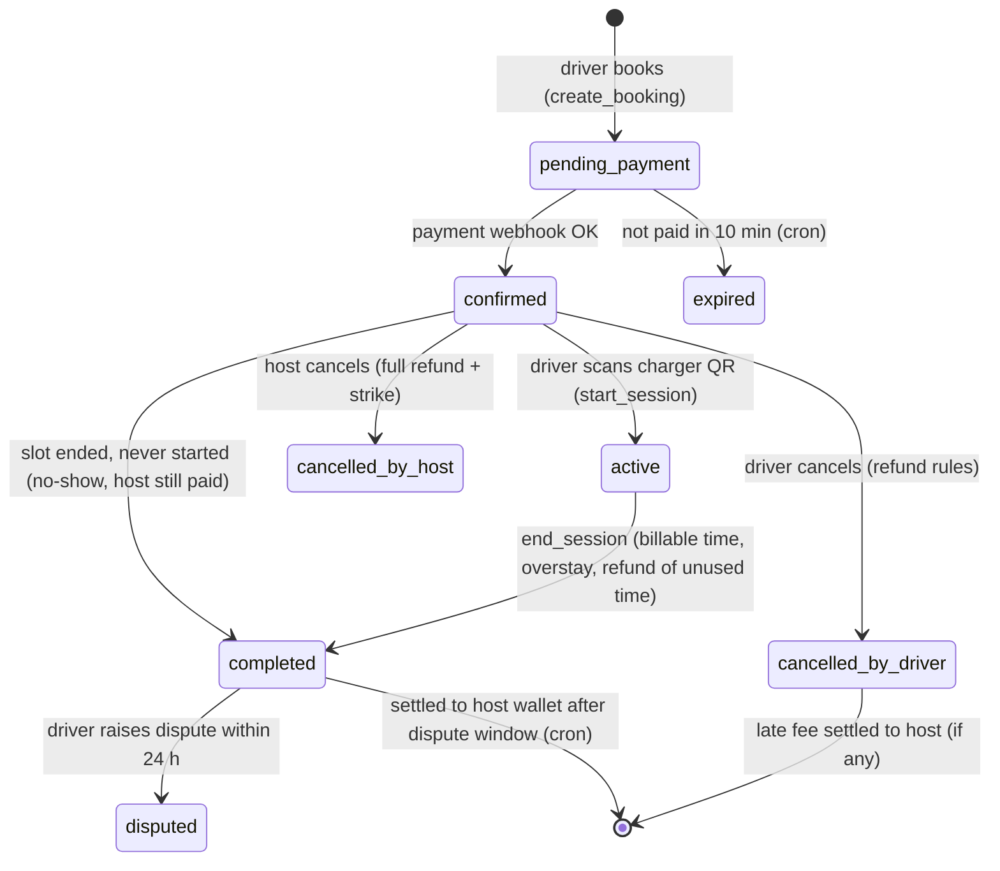
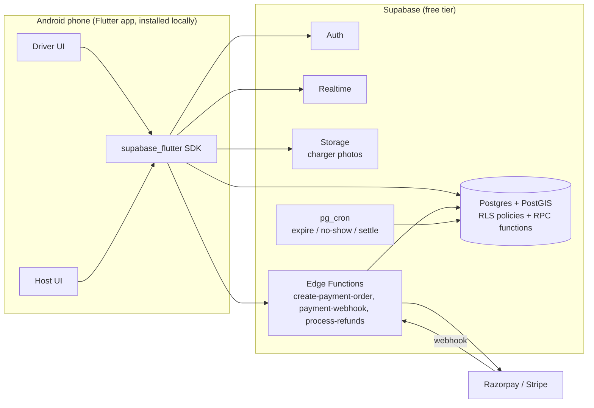

# ⚡ ChargeShare — Peer-to-Peer EV Charger Rental

> We can't build public charging stations everywhere. But thousands of EV owners already have a charger sitting idle ~22 hours a day. **ChargeShare lets them rent it out and lets other EV drivers book it nearby.**

**Stack:** Flutter (Android, local install / APK) · Supabase (Postgres + Auth + Realtime + Storage + Edge Functions, free tier) · Razorpay or Stripe for payments · OpenStreetMap for maps (free).

---

## Table of contents

1. [The idea in one minute](#1-the-idea-in-one-minute)
2. [Users and the two logins](#2-users-and-the-two-logins)
3. [Functional requirements](#3-functional-requirements)
4. [Business logic (the rules of the system)](#4-business-logic)
5. [How to make money](#5-how-to-make-money)
6. [Architecture](#6-architecture)
7. [Database: complete Supabase SQL](#7-database-complete-supabase-sql)
8. [Edge Functions (payments)](#8-edge-functions-payments)
9. [Flutter app: setup and core code](#9-flutter-app)
10. [Step-by-step: from zero to running APK](#10-step-by-step-getting-started)
11. [Roadmap](#11-roadmap)
12. [Legal, safety and risk (read before launching)](#12-legal-safety-and-risk)
13. [KPIs to track](#13-kpis)

---

## 1. The idea in one minute

| | |
|---|---|
| **Supply** | Home / shop / office owners with an EV charger. They use it ~2 hours a day; the other ~22 hours it's idle. |
| **Demand** | EV drivers (especially apartment dwellers, cab/delivery drivers, travellers) who can't find or install a charger nearby. |
| **Our product** | A marketplace: search a nearby charger on a map → book a time slot → pay in-app → check in by scanning a QR on the charger → charge → pay/refund automatically. Host gets money in an in-app wallet and withdraws via UPI/bank. |
| **Fixed pricing** | Prices are **fixed by the platform per charger tier** (e.g. 3.3 kW, 7.4 kW, 22 kW). Hosts cannot change prices. This keeps the app simple, avoids haggling, and makes the platform the price authority. |
| **Our revenue** | Commission from the host + small convenience fee from the driver (+ the extra revenue ideas in section 5). |

---

## 2. Users and the two logins

There are **two separate login experiences** (same auth system, different role stored in `profiles.role`):

### 🚗 Driver login — "I need to charge"
- Sign up / log in with email + password (or Google).
- Add vehicle(s) (connector type, battery size).
- Search chargers on a map, filter by connector and time window.
- Book a slot, pay, scan QR to start, end session, rate the host.
- See booking history, invoices, raise a dispute.

### 🏠 Host login — "I own a charger"
- Sign up / log in. Complete profile + KYC (basic: name, phone, ID photo, UPI/bank).
- List a charger: photos, location pin, tier (power), connector, house rules.
- Set weekly availability. **Example: block your own 2 hours (e.g. 18:00–20:00) → the remaining 22 hours are rentable.**
- Receive realtime booking notifications, see who is coming, when.
- Wallet with earnings, request payout, see statements.
- Pause listing any time.

### 🛡️ Admin (you)
- Approve chargers (safety verification), resolve disputes, handle payouts, edit platform settings. In the MVP you do this from the **Supabase dashboard**; a web admin panel comes later.

> **How the login screen works:** one login page with two tabs ("I need to charge" / "I own a charger"). After sign-in, the app checks that the account's role matches the selected tab. If not, it signs the user out with a clear message. Role is chosen at sign-up and cannot be changed by the user (stops privilege abuse).

---

## 3. Functional requirements

### MVP (build first — ~6 to 8 weeks solo)

**Auth & profile**
- [ ] Email/password signup with role (driver/host)
- [ ] Role-checked login
- [ ] Profile edit (name, phone, avatar)

**Host**
- [ ] Create charger listing (title, address, map pin, tier, connector, photos, rules)
- [ ] Weekly availability editor
- [ ] One-off blocks (own use, travel)
- [ ] Pause/unpause listing
- [ ] View incoming/upcoming/past bookings (realtime)
- [ ] Printable check-in QR for the charger
- [ ] Wallet, transactions, payout request

**Driver**
- [ ] Add vehicle
- [ ] Map search with "available between X and Y" filter
- [ ] Charger detail page (photos, price, rating, rules, busy slots)
- [ ] Quote → book → pay (Razorpay/Stripe)
- [ ] QR check-in → live session timer → end session
- [ ] Cancel booking with refund rules
- [ ] Rate host, raise dispute

**Platform**
- [ ] Double-booking impossible (database-level guarantee)
- [ ] Automatic expiry of unpaid bookings, no-show handling, settlement to host wallet
- [ ] Admin approval of chargers

### v1.1
- Push notifications (Firebase Cloud Messaging), in-app chat, phone OTP login, ratings for drivers, favourites, invoices (PDF), referral codes, multilingual UI.

### v2
- Real energy metering (smart plug/OCPP) → bill per kWh instead of per hour, remote on/off of charger, host subscription plans, fleet/B2B accounts, iOS app, web admin.

---

## 4. Business logic

### 4.1 Pricing (fixed, platform-controlled)

All prices live in table `charger_tiers` and are editable only by you (admin). Example seed (INR — change to your currency):

| Tier | Power | Driver base price / hour | Approx. per kWh |
|---|---|---|---|
| `AC_3`  | 3.3 kW (home socket / slow) | ₹55  | ~₹16.7 |
| `AC_7`  | 7.4 kW (Type 2 wallbox)     | ₹120 | ~₹16.2 |
| `AC_22` | 22 kW AC                    | ₹330 | ~₹15.0 |
| `DC_30` | 30 kW DC (commercial hosts) | ₹600 | ~₹20.0 |

> Why per **hour** in the MVP? Home chargers rarely have a revenue-grade meter. Hourly pricing needs no hardware and is easy to understand. Once you add smart metering (v2) switch to `price_per_kwh` (column already present).

**Fees (all configurable in `platform_settings`):**

| Fee | Default | Paid by | Notes |
|---|---|---|---|
| Host commission | 15% of base | Deducted from host earning | Core revenue |
| Driver convenience fee | 5% of base (min ₹5) | Added on top for driver | Core revenue |
| Late-cancel fee | 30% of base | Driver | Goes to host (minus commission) |
| Overstay multiplier | 1.5× hourly rate per 15 min | Driver | After 10 min grace |
| Payment gateway cost | ~2% | Absorbed by platform | Don't forget this in your margins |

**Worked example — 3-hour booking on a 7.4 kW charger**

```
Base            = 3 h × ₹120                 = ₹360
Driver fee      = max(5% × 360, ₹5)          = ₹18
Driver pays     = 360 + 18                   = ₹378
Host commission = 15% × 360                  = ₹54
Host earns      = 360 − 54                   = ₹306
Platform gross  = 54 + 18                    = ₹72   (≈ ₹65 after ~2% gateway fee on ₹378)
Host's power cost ≈ 20 kWh × ₹7              ≈ ₹140  → host net ≈ ₹166 per booking
```

### 4.2 Booking lifecycle (state machine)



### 4.3 Availability & double-booking prevention

1. Host defines **weekly rules** in `charger_availability` (day of week + start/end time in the charger's local time zone). Example for a host who uses the charger 18:00–20:00 every day:
   `00:00–18:00` and `20:00–24:00` for each weekday → the 2 hours of own use are never bookable.
2. Host can add **one-off blocks** in `charger_blocks` (travel, maintenance).
3. A booking must fit **entirely inside one availability rule**, be aligned to 30-min slots, 30 min – 12 h long.
4. **Double-booking is blocked by Postgres itself**: an `EXCLUDE USING gist` constraint on `(charger_id, during)` for active statuses. Even if two drivers tap "Book" in the same millisecond, one will get a `slot_taken` error. No race conditions.
5. Unpaid bookings hold the slot for 10 minutes, then auto-expire and the slot is released.
6. If a driver ends early, the unused part of the slot is **released** so others can book it.

### 4.4 Check-in (proof the driver is at the charger)

- Each charger gets a secret `checkin_code`, shown to the host as a **QR sticker to print and put on the charger**.
- Driver scans the QR in the app → `start_session(booking_id, code)` → allowed from 15 min before slot start until slot end.
- Host receives a realtime "Session started" notification.
- (v2: the same call switches a smart plug on.)

### 4.5 Billing at the end of a session

- **Billable time** = from slot start to the moment the driver ends, rounded **up** to the 30-min slot, minimum 30 min, capped at booked time.
  (If the driver arrives late the booked time is still billed — the host kept the slot free for them.)
- **Unused paid time is refunded** automatically (`refund_amount`, processed by an Edge Function).
- **Overstay:** after a 10-min grace, each started 15 min is billed at 1.5× rate. It is added to `profiles.outstanding_due`; a driver with dues **cannot book again** until paid.
- **Host earning** = (billable amount + overstay) − commission.

### 4.6 Cancellation & no-show

| Who / when | Result |
|---|---|
| Driver, before payment | Booking expires, nothing charged |
| Driver, ≥ 2 h before start | Full refund |
| Driver, < 2 h before start | 30% of base kept as late-cancel fee (host gets it minus commission), rest refunded |
| Host cancels (any time) | Full refund to driver, host gets a **strike** (3 strikes → listing paused, review by admin) |
| Driver no-show | Full booked amount charged; host earns normally |

### 4.7 Money flow, wallet and payouts

```
Driver ──pays──▶ Payment gateway ──▶ Platform account
                                          │
                 completed + 24 h dispute window passes (cron: settle_due_bookings)
                                          ▼
                                   Host wallet (+ host_earning)
                                          │  request_payout (min ₹200)
                                          ▼
                              Admin / RazorpayX / UPI payout
```

- Money is credited to the host **only after the 24 h dispute window** — protects against fraud and chargebacks.
- Every movement is recorded in `wallet_transactions` (an audit trail / ledger).
- MVP payouts: you pay hosts manually (UPI) once a week from the admin dashboard and mark the payout `paid`. Automate with RazorpayX / Stripe Connect later.

### 4.8 Ratings, trust & safety

- Two-way ratings (driver ↔ host) after a completed session.
- Charger goes live only after **admin verification** (`status = active`).
- Safety checklist host must confirm: dedicated circuit, MCB/RCCB, proper earthing, weatherproof outlet, no extension cords, EV-rated cable.
- 3 host strikes → auto-pause. Drivers with unpaid dues cannot book.
- Disputes: driver can flag a completed session within 24 h → status `disputed`, settlement is held until admin resolves.

---

## 5. How to make money

### 5.1 Core revenue (turn on at launch)

| # | Stream | How it works | Effort |
|---|---|---|---|
| 1 | **Host commission** | 10–20% of every booking, deducted from host earning. | Built-in |
| 2 | **Driver convenience fee** | 3–8% (min ₹5) added at checkout. | Built-in |
| 3 | **Late-cancel & overstay fees** | Penalties; part goes to host, part to you. Also protects hosts → improves supply quality. | Built-in |
| 4 | **Peak-hour pricing (still fixed!)** | You — not the host — set a platform-wide multiplier (e.g. 1.2× from 6–10 pm weekdays). Prices remain fixed/transparent, you capture the demand peak. | Small (add `peak_rules` table) |

### 5.2 Growth revenue (after ~500 active bookings/month)

| # | Stream | How it works |
|---|---|---|
| 5 | **Driver subscription "ChargeShare Plus"** | ₹149–299/month: 0% convenience fee, priority booking, free cancellation, 5% discount. Predictable recurring revenue. |
| 6 | **Host "Pro" subscription** | ₹199–499/month: lower commission (10%), featured listing, analytics, auto-payout, smart-plug integration. |
| 7 | **Featured / boosted listings** | Hosts pay a small fee to appear at the top of search in their area. |
| 8 | **Sell/rent hardware** | Smart plug + energy meter (Shelly, Tuya or ESP32-based OCPP controller) bundled with install. Margin on hardware + unlocks per-kWh billing. Partner with a charger OEM for referral fees. |
| 9 | **Insurance add-on** | Optional ₹10–20 per booking cover (equipment damage, liability) via an insurance partner; you earn commission on each policy. |
| 10 | **Referral & partnership fees** | EV dealerships and EV makers pay per lead/new EV owner you onboard; electricians/installers pay for leads of people wanting a wallbox. |

### 5.3 B2B and scale revenue

| # | Stream | How it works |
|---|---|---|
| 11 | **Fleet accounts** | Delivery companies / cab fleets / corporates book chargers in bulk with monthly invoicing and a dashboard. Higher volume, steadier. |
| 12 | **Apartment societies (RWAs) & malls** | Sell a white-label "shared charger management" subscription (per-charger SaaS fee) — society's own chargers become a rental pool. |
| 13 | **Employer / workplace charging** | Companies sponsor employees' charging at partner homes near the office. |
| 14 | **Location sponsorship & ads** | Cafés, restaurants, malls near hosts pay to be shown to drivers "while you wait 1 hour" (keep this tasteful). |
| 15 | **Data & insights** | Anonymised demand heatmaps sold to city planners, DISCOMs, charging network operators and real-estate developers. |
| 16 | **Carbon credits / green reports** | Aggregate usage of EV charging, issue ESG reports for corporate customers; explore carbon credit programmes. |
| 17 | **Charger-installation marketplace** | Verified electricians quote installation; you earn a referral on each job → grows supply. |

### 5.4 Illustrative unit economics (assumptions, not promises)

Assume **1,000 listed chargers**, **40 bookings per charger per month**, **₹150 average base** per booking:

```
GMV (base)               = 1,000 × 40 × ₹150          = ₹60,00,000 / month
Host commission (15%)                                   = ₹9,00,000
Driver fee (5%)                                         = ₹3,00,000
Gross platform revenue                                  = ₹12,00,000
Gateway fees (~2% of ₹63 lakh charged)                  ≈ −₹1,26,000
Net before fixed costs                                  ≈ ₹10.7 lakh / month

Host side (per charger): 40 × ₹150 × 85% = ₹5,100 revenue
                         − electricity (~₹3,000) = ~₹2,100 / month profit
```

**Honest takeaway:** hosts earn real but modest money from idle capacity. Your platform margin is healthy only with *volume*. The levers that move the business most are **utilisation (bookings per charger)**, **supply density in a few neighbourhoods**, and **recurring revenue (subscriptions, B2B)**. Launch in 1–2 dense areas first, not a whole country.

### 5.5 Go-to-market tips

1. **Start hyper-local** (one city area with many EVs and apartments). Marketplace apps die from thin supply.
2. **Seed supply first**: sign up 20–30 hosts personally (EV owner groups on WhatsApp/Telegram, EV dealerships, housing societies).
3. **Guarantee host earnings** for the first 2 months (e.g. ₹1,500 minimum) — cheap way to bootstrap trust.
4. Target **cab and delivery EV drivers** early: they need frequent charging and book repeatedly.
5. Make the host's side effortless: print the QR sticker, one-tap pause, weekly auto-payout.

---

## 6. Architecture



**Key design decisions**

- **All money-sensitive logic lives in the database/Edge Functions, never in the app.** The app only calls RPC functions (`create_booking`, `start_session`, …). Clients have no direct write access to `bookings`, `payments`, `wallets`.
- **Row Level Security (RLS)** on every table; users only see what they should.
- The Flutter app is installed locally (APK); only data lives in Supabase. The app contains **only the anon key** (safe by design thanks to RLS). **Never put the `service_role` key in the app.**
- Free tier limits (check current numbers at supabase.com/pricing): ~500 MB database, 1 GB file storage, 50k monthly active users. Note: free projects **pause after about a week of inactivity** — fine for development; move to a paid plan before launch.
- Maps: `flutter_map` with OpenStreetMap tiles (no API key). OSM's public tile servers are for light/dev use; use a provider such as MapTiler/Stadia (free tiers) in production.

---

## 7. Database: complete Supabase SQL

Run this **in order** in *Supabase Dashboard → SQL Editor* (save it as `supabase/migrations/0001_init.sql`).

### 7.1 Extensions, enums, settings

```sql
-- ===== 0. EXTENSIONS =====
create extension if not exists postgis;
create extension if not exists btree_gist;   -- needed for the double-booking exclusion constraint
create extension if not exists pg_cron;      -- if this errors: Dashboard > Database > Extensions > enable pg_cron

-- ===== 1. ENUMS =====
create type user_role        as enum ('driver', 'host', 'admin');
create type charger_status   as enum ('pending_verification', 'active', 'rejected');
create type connector_type   as enum ('type1', 'type2', 'ccs2', 'chademo', 'gbt', 'three_pin', 'other');
create type booking_status   as enum (
  'pending_payment', 'confirmed', 'active', 'completed',
  'cancelled_by_driver', 'cancelled_by_host', 'expired', 'disputed'
);
create type payment_status   as enum ('created', 'paid', 'failed', 'refund_pending', 'refunded');
create type payout_status    as enum ('requested', 'processing', 'paid', 'failed');

-- ===== 2. PLATFORM SETTINGS (editable by admin only) =====
create table platform_settings (
  key        text primary key,
  value      jsonb not null,
  updated_at timestamptz not null default now()
);

insert into platform_settings (key, value) values
  ('currency',                    '"INR"'),
  ('host_commission_pct',         '15'),
  ('driver_fee_pct',              '5'),
  ('driver_fee_min',              '5'),
  ('slot_minutes',                '30'),
  ('min_booking_minutes',         '30'),
  ('max_booking_minutes',         '720'),
  ('pending_payment_ttl_minutes', '10'),
  ('free_cancel_hours',           '2'),
  ('late_cancel_fee_pct',         '30'),
  ('overstay_multiplier',         '1.5'),
  ('overstay_grace_minutes',      '10'),
  ('dispute_window_hours',        '24'),
  ('min_payout',                  '200'),
  ('checkin_early_minutes',       '15');

create or replace function setting_num(k text) returns numeric
language sql stable as $$
  select (value #>> '{}')::numeric from platform_settings where key = k
$$;
```

### 7.2 Tables

```sql
-- ===== 3. PROFILES (1:1 with auth.users) =====
create table profiles (
  id              uuid primary key references auth.users(id) on delete cascade,
  role            user_role not null default 'driver',
  full_name       text not null default '',
  phone           text,
  avatar_url      text,
  kyc_status      text not null default 'none' check (kyc_status in ('none','submitted','verified','rejected')),
  rating_avg      numeric(3,2) not null default 0,
  rating_count    int not null default 0,
  strikes         int not null default 0,
  outstanding_due numeric(10,2) not null default 0,   -- unpaid overstay fees (driver)
  created_at      timestamptz not null default now()
);

create table vehicles (
  id           uuid primary key default gen_random_uuid(),
  driver_id    uuid not null references profiles(id) on delete cascade,
  make         text not null,
  model        text not null,
  connector    connector_type not null,
  battery_kwh  numeric(5,1),
  plate_number text,
  created_at   timestamptz not null default now()
);

-- ===== 4. FIXED PRICING TIERS (admin-only) =====
create table charger_tiers (
  code           text primary key,
  label          text not null,
  power_kw       numeric(5,1) not null,
  price_per_hour numeric(10,2) not null,
  price_per_kwh  numeric(10,2),            -- used in v2 with metering
  is_active      boolean not null default true
);

insert into charger_tiers (code, label, power_kw, price_per_hour, price_per_kwh) values
  ('AC_3',  'AC 3.3 kW (home socket / slow)',  3.3,  55.00, 16.70),
  ('AC_7',  'AC 7.4 kW (Type 2 wallbox)',      7.4, 120.00, 16.20),
  ('AC_22', 'AC 22 kW',                       22.0, 330.00, 15.00),
  ('DC_30', 'DC 30 kW (commercial)',          30.0, 600.00, 20.00);

-- ===== 5. CHARGERS =====
create table chargers (
  id            uuid primary key default gen_random_uuid(),
  host_id       uuid not null references profiles(id) on delete cascade,
  title         text not null,
  description   text,
  address       text not null,
  location      geography(point, 4326) not null,
  timezone      text not null default 'Asia/Kolkata',  -- change for your country
  tier_code     text not null references charger_tiers(code),
  connector     connector_type not null,
  photos        text[] not null default '{}',
  rules         text,
  status        charger_status not null default 'pending_verification',
  safety_checked boolean not null default false,
  is_paused     boolean not null default false,
  rating_avg    numeric(3,2) not null default 0,
  rating_count  int not null default 0,
  created_at    timestamptz not null default now()
);
create index chargers_location_gix on chargers using gist (location);
create index chargers_host_idx on chargers (host_id);

-- secret check-in code (printed as QR). Hosts can read it; drivers cannot.
create table charger_secrets (
  charger_id   uuid primary key references chargers(id) on delete cascade,
  checkin_code text not null default substr(md5(random()::text || clock_timestamp()::text), 1, 10)
);

create or replace function create_charger_secret() returns trigger
language plpgsql security definer set search_path = public as $$
begin
  insert into charger_secrets (charger_id) values (new.id);
  return new;
end $$;
create trigger trg_charger_secret after insert on chargers
  for each row execute function create_charger_secret();

-- weekly recurring availability, local time of the charger. 24:00 is allowed as end_time.
create table charger_availability (
  id          uuid primary key default gen_random_uuid(),
  charger_id  uuid not null references chargers(id) on delete cascade,
  day_of_week smallint not null check (day_of_week between 0 and 6),  -- 0 = Sunday
  start_time  time not null,
  end_time    time not null,
  check (end_time > start_time)
);
create index charger_avail_idx on charger_availability (charger_id, day_of_week);

-- one-off blocks (host's own use, travel, maintenance)
create table charger_blocks (
  id         uuid primary key default gen_random_uuid(),
  charger_id uuid not null references chargers(id) on delete cascade,
  during     tstzrange not null,
  reason     text,
  exclude using gist (charger_id with =, during with &&)
);

-- ===== 6. BOOKINGS =====
create table bookings (
  id                 uuid primary key default gen_random_uuid(),
  charger_id         uuid not null references chargers(id),
  driver_id          uuid not null references profiles(id),
  vehicle_id         uuid references vehicles(id),
  during             tstzrange not null,
  status             booking_status not null default 'pending_payment',
  hours              numeric(6,2) not null,
  base_amount        numeric(10,2) not null,      -- what was quoted (before fees)
  driver_fee         numeric(10,2) not null,
  total_amount       numeric(10,2) not null,      -- what driver pays up front
  host_commission    numeric(10,2) not null,
  host_earning       numeric(10,2) not null,
  final_base_amount  numeric(10,2),               -- after early end
  overstay_minutes   int not null default 0,
  overstay_amount    numeric(10,2) not null default 0,
  refund_amount      numeric(10,2) not null default 0,
  refund_status      text not null default 'none' check (refund_status in ('none','pending','done')),
  no_show            boolean not null default false,
  started_at         timestamptz,
  ended_at           timestamptz,
  settled_at         timestamptz,
  cancel_reason      text,
  dispute_reason     text,
  created_at         timestamptz not null default now(),
  -- THE double-booking guarantee:
  constraint no_overlapping_bookings
    exclude using gist (charger_id with =, during with &&)
    where (status in ('pending_payment','confirmed','active','completed'))
);
create index bookings_driver_idx  on bookings (driver_id, created_at desc);
create index bookings_charger_idx on bookings (charger_id, created_at desc);
create index bookings_status_idx  on bookings (status);

-- ===== 7. PAYMENTS, WALLET, PAYOUTS, REVIEWS =====
create table payments (
  id                   uuid primary key default gen_random_uuid(),
  booking_id           uuid not null references bookings(id),
  provider             text not null default 'razorpay',
  provider_order_id    text unique,
  provider_payment_id  text,
  amount               numeric(10,2) not null,
  currency             text not null default 'INR',
  status               payment_status not null default 'created',
  created_at           timestamptz not null default now(),
  paid_at              timestamptz
);
create index payments_booking_idx on payments (booking_id);

create table wallets (
  user_id uuid primary key references profiles(id) on delete cascade,
  balance numeric(12,2) not null default 0 check (balance >= 0)
);

create table wallet_transactions (
  id            uuid primary key default gen_random_uuid(),
  user_id       uuid not null references profiles(id),
  booking_id    uuid references bookings(id),
  kind          text not null check (kind in ('earning','payout','adjustment')),
  amount        numeric(12,2) not null,           -- signed
  balance_after numeric(12,2) not null,
  note          text,
  created_at    timestamptz not null default now()
);
create index wtx_user_idx on wallet_transactions (user_id, created_at desc);

create table payouts (
  id           uuid primary key default gen_random_uuid(),
  host_id      uuid not null references profiles(id),
  amount       numeric(12,2) not null,
  upi_id       text,
  bank_details text,
  status       payout_status not null default 'requested',
  requested_at timestamptz not null default now(),
  processed_at timestamptz,
  reference    text
);

create table reviews (
  id          uuid primary key default gen_random_uuid(),
  booking_id  uuid not null references bookings(id),
  reviewer_id uuid not null references profiles(id),
  reviewee_id uuid not null references profiles(id),
  rating      smallint not null check (rating between 1 and 5),
  comment     text,
  created_at  timestamptz not null default now(),
  unique (booking_id, reviewer_id)
);
```

### 7.3 Auth trigger and helper functions

```sql
-- ===== 8. NEW USER => PROFILE + WALLET =====
create or replace function handle_new_user() returns trigger
language plpgsql security definer set search_path = public as $$
declare v_role user_role;
begin
  -- users may only self-select driver or host. 'admin' is set manually by you.
  v_role := case when new.raw_user_meta_data->>'role' = 'host'
                 then 'host'::user_role else 'driver'::user_role end;
  insert into profiles (id, role, full_name)
  values (new.id, v_role, coalesce(new.raw_user_meta_data->>'full_name', ''));
  insert into wallets (user_id) values (new.id);
  return new;
end $$;

create trigger on_auth_user_created after insert on auth.users
  for each row execute function handle_new_user();

-- safe public view of profiles (no phone, dues, etc.)
create view public_profiles as
  select id, full_name, avatar_url, rating_avg, rating_count, role from profiles;
```

### 7.4 Business-logic functions (the "backend")

```sql
-- ===== 9. AVAILABILITY CHECK =====
create or replace function is_within_availability(p_charger uuid, p_start timestamptz, p_end timestamptz)
returns boolean language plpgsql stable security definer set search_path = public as $$
declare v_tz text; v_ls timestamp; v_le timestamp; v_end_t time;
begin
  select timezone into v_tz from chargers where id = p_charger;
  v_ls := p_start at time zone v_tz;
  v_le := p_end   at time zone v_tz;
  if v_le::date = v_ls::date then
    v_end_t := v_le::time;
  elsif v_le = (v_ls::date + 1)::timestamp then   -- ends exactly at local midnight
    v_end_t := time '24:00';
  else
    return false;                                  -- MVP: a booking cannot span days
  end if;
  return exists (
    select 1 from charger_availability a
    where a.charger_id = p_charger
      and a.day_of_week = extract(dow from v_ls)::int
      and a.start_time <= v_ls::time
      and a.end_time   >= v_end_t
  );
end $$;

-- ===== 10. QUOTE =====
create or replace function quote_booking(p_charger uuid, p_start timestamptz, p_end timestamptz)
returns jsonb language plpgsql stable security definer set search_path = public as $$
declare v_rate numeric; v_hours numeric; v_base numeric; v_dfee numeric; v_comm numeric;
begin
  select t.price_per_hour into v_rate
  from chargers c join charger_tiers t on t.code = c.tier_code where c.id = p_charger;
  if v_rate is null then raise exception 'charger_not_found'; end if;

  v_hours := extract(epoch from (p_end - p_start)) / 3600.0;
  v_base  := round(v_rate * v_hours, 2);
  v_dfee  := greatest(round(v_base * setting_num('driver_fee_pct') / 100, 2), setting_num('driver_fee_min'));
  v_comm  := round(v_base * setting_num('host_commission_pct') / 100, 2);

  return jsonb_build_object(
    'hours', v_hours, 'rate', v_rate, 'base_amount', v_base,
    'driver_fee', v_dfee, 'total', v_base + v_dfee,
    'host_commission', v_comm, 'host_earning', v_base - v_comm
  );
end $$;

-- ===== 11. SEARCH =====
create or replace function nearby_chargers(
  p_lat double precision, p_lng double precision, p_radius_m int default 5000,
  p_start timestamptz default null, p_end timestamptz default null,
  p_connector connector_type default null
) returns table (
  id uuid, title text, address text, lat double precision, lng double precision,
  distance_m double precision, tier_code text, power_kw numeric, price_per_hour numeric,
  connector connector_type, rating_avg numeric, rating_count int, host_name text
) language sql stable security definer set search_path = public as $$
  select c.id, c.title, c.address,
         ST_Y(c.location::geometry), ST_X(c.location::geometry),
         ST_Distance(c.location, ST_SetSRID(ST_MakePoint(p_lng, p_lat), 4326)::geography),
         c.tier_code, t.power_kw, t.price_per_hour, c.connector,
         c.rating_avg, c.rating_count, p.full_name
  from chargers c
  join charger_tiers t on t.code = c.tier_code
  join profiles p on p.id = c.host_id
  where c.status = 'active' and not c.is_paused
    and ST_DWithin(c.location, ST_SetSRID(ST_MakePoint(p_lng, p_lat), 4326)::geography, p_radius_m)
    and (p_connector is null or c.connector = p_connector)
    and (p_start is null or p_end is null or (
          is_within_availability(c.id, p_start, p_end)
          and not exists (select 1 from bookings b
                          where b.charger_id = c.id
                            and b.status in ('pending_payment','confirmed','active','completed')
                            and b.during && tstzrange(p_start, p_end))
          and not exists (select 1 from charger_blocks k
                          where k.charger_id = c.id and k.during && tstzrange(p_start, p_end))
        ))
  order by 6
  limit 50;
$$;

-- busy slots for the booking calendar (drivers can't read bookings directly)
create or replace function get_busy_slots(p_charger uuid, p_from timestamptz, p_to timestamptz)
returns table (slot_start timestamptz, slot_end timestamptz)
language sql stable security definer set search_path = public as $$
  select lower(during), upper(during) from bookings
   where charger_id = p_charger
     and status in ('pending_payment','confirmed','active','completed')
     and during && tstzrange(p_from, p_to)
  union all
  select lower(during), upper(during) from charger_blocks
   where charger_id = p_charger and during && tstzrange(p_from, p_to)
  order by 1;
$$;

-- ===== 12. CREATE BOOKING =====
create or replace function create_booking(p_charger uuid, p_vehicle uuid, p_start timestamptz, p_end timestamptz)
returns bookings language plpgsql security definer set search_path = public as $$
declare
  v_ch chargers; v_prof profiles; v_q jsonb; v_b bookings;
  v_mins numeric; v_slot int := setting_num('slot_minutes')::int; v_ls timestamp; v_le timestamp;
begin
  if auth.uid() is null then raise exception 'not_authenticated'; end if;

  select * into v_prof from profiles where id = auth.uid();
  if v_prof.role <> 'driver' then raise exception 'only_drivers_can_book'; end if;
  if v_prof.outstanding_due > 0 then raise exception 'outstanding_dues'; end if;

  select * into v_ch from chargers where id = p_charger and status = 'active' and not is_paused;
  if not found then raise exception 'charger_unavailable'; end if;
  if v_ch.host_id = auth.uid() then raise exception 'cannot_book_own_charger'; end if;

  if p_start < now() then raise exception 'start_in_past'; end if;
  v_mins := extract(epoch from (p_end - p_start)) / 60;
  if v_mins < setting_num('min_booking_minutes') or v_mins > setting_num('max_booking_minutes') then
    raise exception 'invalid_duration';
  end if;

  v_ls := p_start at time zone v_ch.timezone;
  v_le := p_end   at time zone v_ch.timezone;
  if mod(extract(minute from v_ls)::int, v_slot) <> 0 or mod(extract(minute from v_le)::int, v_slot) <> 0
     or extract(second from v_ls) <> 0 or extract(second from v_le) <> 0 then
    raise exception 'not_slot_aligned';
  end if;

  if p_vehicle is not null and not exists (select 1 from vehicles where id = p_vehicle and driver_id = auth.uid()) then
    raise exception 'invalid_vehicle';
  end if;

  if not is_within_availability(p_charger, p_start, p_end) then raise exception 'outside_availability'; end if;
  if exists (select 1 from charger_blocks k where k.charger_id = p_charger and k.during && tstzrange(p_start, p_end)) then
    raise exception 'host_blocked';
  end if;

  v_q := quote_booking(p_charger, p_start, p_end);

  begin
    insert into bookings (charger_id, driver_id, vehicle_id, during, status, hours,
                          base_amount, driver_fee, total_amount, host_commission, host_earning)
    values (p_charger, auth.uid(), p_vehicle, tstzrange(p_start, p_end, '[)'), 'pending_payment',
            (v_q->>'hours')::numeric, (v_q->>'base_amount')::numeric, (v_q->>'driver_fee')::numeric,
            (v_q->>'total')::numeric, (v_q->>'host_commission')::numeric, (v_q->>'host_earning')::numeric)
    returning * into v_b;
  exception when exclusion_violation then
    raise exception 'slot_taken';
  end;

  return v_b;
end $$;

-- ===== 13. START SESSION (QR check-in) =====
create or replace function start_session(p_booking uuid, p_code text)
returns bookings language plpgsql security definer set search_path = public as $$
declare b bookings; v_code text;
begin
  select * into b from bookings where id = p_booking for update;
  if not found or b.driver_id <> auth.uid() then raise exception 'forbidden'; end if;
  if b.status <> 'confirmed' then raise exception 'not_confirmed'; end if;
  if now() < lower(b.during) - make_interval(mins => setting_num('checkin_early_minutes')::int)
     or now() >= upper(b.during) then
    raise exception 'outside_checkin_window';
  end if;
  select checkin_code into v_code from charger_secrets where charger_id = b.charger_id;
  if v_code is distinct from p_code then raise exception 'wrong_code'; end if;

  update bookings set status = 'active', started_at = now() where id = b.id returning * into b;
  return b;
end $$;

-- ===== 14. END SESSION (billing, early-end refund, overstay) =====
create or replace function end_session(p_booking uuid)
returns bookings language plpgsql security definer set search_path = public as $$
declare
  b bookings; v_host uuid; v_rate numeric; v_slot numeric := setting_num('slot_minutes');
  v_booked_min numeric; v_used_min numeric; v_bill_min numeric;
  v_over_min numeric := 0; v_over_amt numeric := 0; v_final numeric; v_comm numeric;
begin
  select * into b from bookings where id = p_booking for update;
  if not found or b.status <> 'active' then raise exception 'session_not_active'; end if;

  select c.host_id, t.price_per_hour into v_host, v_rate
  from chargers c join charger_tiers t on t.code = c.tier_code where c.id = b.charger_id;
  if auth.uid() not in (b.driver_id, v_host) then raise exception 'forbidden'; end if;

  v_booked_min := extract(epoch from (upper(b.during) - lower(b.during))) / 60;
  v_used_min   := greatest(extract(epoch from (now() - lower(b.during))) / 60, 0);
  v_bill_min   := least(v_booked_min,
                        greatest(setting_num('min_booking_minutes'), ceil(v_used_min / v_slot) * v_slot));

  if now() > upper(b.during) + make_interval(mins => setting_num('overstay_grace_minutes')::int) then
    v_over_min := ceil(extract(epoch from (now() - upper(b.during))) / 60 / 15) * 15;
    v_over_amt := round(v_rate * v_over_min / 60 * setting_num('overstay_multiplier'), 2);
  end if;

  v_final := round(v_rate * v_bill_min / 60, 2);
  v_comm  := round((v_final + v_over_amt) * setting_num('host_commission_pct') / 100, 2);

  update bookings set
    status            = 'completed',
    ended_at          = now(),
    during            = tstzrange(lower(b.during), lower(b.during) + make_interval(mins => v_bill_min::int), '[)'),  -- releases unused slot time
    final_base_amount = v_final,
    overstay_minutes  = v_over_min::int,
    overstay_amount   = v_over_amt,
    host_commission   = v_comm,
    host_earning      = v_final + v_over_amt - v_comm,
    refund_amount     = greatest(b.base_amount - v_final, 0),
    refund_status     = case when b.base_amount - v_final > 0 then 'pending' else 'none' end
  where id = b.id returning * into b;

  if v_over_amt > 0 then
    update profiles set outstanding_due = outstanding_due + v_over_amt where id = b.driver_id;
  end if;
  return b;
end $$;

-- ===== 15. CANCEL BOOKING =====
create or replace function cancel_booking(p_booking uuid, p_reason text default null)
returns bookings language plpgsql security definer set search_path = public as $$
declare b bookings; v_host uuid; v_late numeric := 0; v_comm numeric := 0;
begin
  select * into b from bookings where id = p_booking for update;
  if not found then raise exception 'not_found'; end if;
  if b.status not in ('pending_payment', 'confirmed') then raise exception 'cannot_cancel'; end if;
  select host_id into v_host from chargers where id = b.charger_id;

  if auth.uid() = b.driver_id then
    if b.status = 'confirmed'
       and lower(b.during) - now() < make_interval(hours => setting_num('free_cancel_hours')::int) then
      v_late := round(b.base_amount * setting_num('late_cancel_fee_pct') / 100, 2);
    end if;
    v_comm := round(v_late * setting_num('host_commission_pct') / 100, 2);
    update bookings set
      status = 'cancelled_by_driver', ended_at = now(), cancel_reason = p_reason,
      refund_amount = case when b.status = 'confirmed' then b.total_amount - v_late else 0 end,
      refund_status = case when b.status = 'confirmed' then 'pending' else 'none' end,
      host_commission = v_comm, host_earning = v_late - v_comm
    where id = b.id returning * into b;

  elsif auth.uid() = v_host then
    update bookings set
      status = 'cancelled_by_host', ended_at = now(), cancel_reason = p_reason,
      refund_amount = case when b.status = 'confirmed' then b.total_amount else 0 end,
      refund_status = case when b.status = 'confirmed' then 'pending' else 'none' end,
      host_commission = 0, host_earning = 0
    where id = b.id returning * into b;
    update profiles set strikes = strikes + 1 where id = v_host;

  else
    raise exception 'forbidden';
  end if;
  return b;
end $$;

-- ===== 16. DISPUTE =====
create or replace function raise_dispute(p_booking uuid, p_reason text)
returns bookings language plpgsql security definer set search_path = public as $$
declare b bookings;
begin
  select * into b from bookings where id = p_booking for update;
  if not found or b.driver_id <> auth.uid() then raise exception 'forbidden'; end if;
  if b.status <> 'completed' or b.settled_at is not null
     or now() > b.ended_at + make_interval(hours => setting_num('dispute_window_hours')::int) then
    raise exception 'dispute_not_allowed';
  end if;
  update bookings set status = 'disputed', dispute_reason = p_reason where id = b.id returning * into b;
  return b;
end $$;

-- ===== 17. REVIEWS =====
create or replace function submit_review(p_booking uuid, p_rating int, p_comment text default null)
returns void language plpgsql security definer set search_path = public as $$
declare b bookings; v_host uuid; v_reviewee uuid;
begin
  select * into b from bookings where id = p_booking;
  if not found or b.status <> 'completed' then raise exception 'not_reviewable'; end if;
  select host_id into v_host from chargers where id = b.charger_id;
  if auth.uid() = b.driver_id then v_reviewee := v_host;
  elsif auth.uid() = v_host then v_reviewee := b.driver_id;
  else raise exception 'forbidden'; end if;

  insert into reviews (booking_id, reviewer_id, reviewee_id, rating, comment)
  values (p_booking, auth.uid(), v_reviewee, p_rating, p_comment);

  update profiles p set
    rating_avg   = coalesce((select round(avg(rating), 2) from reviews where reviewee_id = v_reviewee), 0),
    rating_count = (select count(*) from reviews where reviewee_id = v_reviewee)
  where p.id = v_reviewee;

  if auth.uid() = b.driver_id then
    update chargers c set
      rating_avg   = coalesce((select round(avg(r.rating), 2) from reviews r join bookings bk on bk.id = r.booking_id
                               where bk.charger_id = c.id and r.reviewer_id = bk.driver_id), 0),
      rating_count = (select count(*) from reviews r join bookings bk on bk.id = r.booking_id
                      where bk.charger_id = c.id and r.reviewer_id = bk.driver_id)
    where c.id = b.charger_id;
  end if;
end $$;

-- ===== 18. PAYOUT REQUEST (host) =====
create or replace function request_payout(p_amount numeric, p_upi text)
returns payouts language plpgsql security definer set search_path = public as $$
declare v_bal numeric; v_p payouts;
begin
  if (select role from profiles where id = auth.uid()) <> 'host' then raise exception 'only_hosts'; end if;
  if p_amount < setting_num('min_payout') then raise exception 'below_min_payout'; end if;

  update wallets set balance = balance - p_amount
   where user_id = auth.uid() and balance >= p_amount
   returning balance into v_bal;
  if not found then raise exception 'insufficient_balance'; end if;

  insert into payouts (host_id, amount, upi_id) values (auth.uid(), p_amount, p_upi) returning * into v_p;
  insert into wallet_transactions (user_id, kind, amount, balance_after, note)
  values (auth.uid(), 'payout', -p_amount, v_bal, 'Payout request ' || v_p.id);
  return v_p;
end $$;
```

### 7.5 Server-only functions (called by Edge Functions / cron, never by the app)

```sql
-- ===== 19. PAYMENT CONFIRMATION (called by webhook with service_role) =====
create or replace function confirm_booking_payment(p_booking uuid, p_provider_payment_id text, p_amount numeric)
returns void language plpgsql security definer set search_path = public as $$
begin
  update payments set status = 'paid', provider_payment_id = p_provider_payment_id, paid_at = now()
   where booking_id = p_booking and status = 'created' and amount = p_amount;
  if not found then return; end if;     -- unknown / duplicate webhook: ignore (idempotent)

  update bookings set status = 'confirmed' where id = p_booking and status = 'pending_payment';
  if not found then
    -- paid after the hold expired / was cancelled => refund it
    update payments set status = 'refund_pending' where booking_id = p_booking and provider_payment_id = p_provider_payment_id;
  end if;
end $$;

-- ===== 20. CRON JOBS =====
create or replace function expire_pending_bookings() returns int
language plpgsql security definer set search_path = public as $$
declare n int;
begin
  update bookings set status = 'expired'
   where status = 'pending_payment'
     and created_at < now() - make_interval(mins => setting_num('pending_payment_ttl_minutes')::int);
  get diagnostics n = row_count;
  return n;
end $$;

create or replace function mark_no_shows() returns int
language plpgsql security definer set search_path = public as $$
declare n int;
begin
  update bookings set status = 'completed', no_show = true,
         ended_at = upper(during), final_base_amount = base_amount
   where status = 'confirmed' and upper(during) < now();
  get diagnostics n = row_count;
  return n;
end $$;

create or replace function settle_due_bookings() returns int
language plpgsql security definer set search_path = public as $$
declare r record; v_bal numeric; n int := 0;
begin
  for r in
    select b.id, b.host_earning, c.host_id
      from bookings b join chargers c on c.id = b.charger_id
     where b.settled_at is null
       and b.host_earning > 0
       and (b.status = 'completed' or b.status = 'cancelled_by_driver')
       and b.ended_at < now() - make_interval(hours => setting_num('dispute_window_hours')::int)
     for update of b skip locked
  loop
    update wallets set balance = balance + r.host_earning where user_id = r.host_id returning balance into v_bal;
    insert into wallet_transactions (user_id, booking_id, kind, amount, balance_after, note)
    values (r.host_id, r.id, 'earning', r.host_earning, v_bal, 'Booking earning');
    update bookings set settled_at = now() where id = r.id;
    n := n + 1;
  end loop;
  return n;
end $$;

-- lock these down: only service_role / cron may run them
revoke execute on function confirm_booking_payment(uuid, text, numeric) from public, anon, authenticated;
revoke execute on function expire_pending_bookings()  from public, anon, authenticated;
revoke execute on function mark_no_shows()            from public, anon, authenticated;
revoke execute on function settle_due_bookings()      from public, anon, authenticated;
grant  execute on function confirm_booking_payment(uuid, text, numeric) to service_role;

select cron.schedule('expire-pending', '* * * * *',    $$select expire_pending_bookings()$$);
select cron.schedule('mark-no-shows',  '*/10 * * * *', $$select mark_no_shows()$$);
select cron.schedule('settle-bookings','*/15 * * * *', $$select settle_due_bookings()$$);
```

### 7.6 Row Level Security (RLS) and grants

```sql
-- ===== 21. RLS =====
alter table platform_settings    enable row level security;
alter table profiles             enable row level security;
alter table vehicles             enable row level security;
alter table charger_tiers        enable row level security;
alter table chargers             enable row level security;
alter table charger_secrets      enable row level security;
alter table charger_availability enable row level security;
alter table charger_blocks       enable row level security;
alter table bookings             enable row level security;
alter table payments             enable row level security;
alter table wallets              enable row level security;
alter table wallet_transactions  enable row level security;
alter table payouts              enable row level security;
alter table reviews              enable row level security;

-- settings & tiers: read-only for logged-in users
create policy "read settings" on platform_settings for select to authenticated using (true);
create policy "read tiers"    on charger_tiers     for select to authenticated using (true);

-- profiles: own row only (others via public_profiles view)
create policy "own profile" on profiles for select to authenticated using (id = auth.uid());
create policy "own profile update" on profiles for update to authenticated using (id = auth.uid());
revoke update on profiles from authenticated;
grant  update (full_name, phone, avatar_url) on profiles to authenticated;   -- role/kyc/strikes/dues are protected
grant  select on public_profiles to authenticated;

-- vehicles: owner full access
create policy "own vehicles" on vehicles for all to authenticated
  using (driver_id = auth.uid()) with check (driver_id = auth.uid());

-- chargers: everyone sees active ones, hosts see/manage their own
create policy "read chargers" on chargers for select to authenticated
  using (status = 'active' or host_id = auth.uid());
create policy "host insert charger" on chargers for insert to authenticated
  with check (host_id = auth.uid()
              and exists (select 1 from profiles where id = auth.uid() and role = 'host'));
create policy "host update charger" on chargers for update to authenticated
  using (host_id = auth.uid());
revoke insert, update on chargers from authenticated;
grant insert (host_id, title, description, address, location, timezone, tier_code, connector, photos, rules)
  on chargers to authenticated;
grant update (title, description, photos, rules, is_paused) on chargers to authenticated;
-- status, safety_checked, tier after approval: admin only (service role / dashboard)

-- check-in secret: only the host
create policy "host reads secret" on charger_secrets for select to authenticated
  using (exists (select 1 from chargers c where c.id = charger_id and c.host_id = auth.uid()));

-- availability: readable by all (needed for UI), editable by the host
create policy "read availability" on charger_availability for select to authenticated using (true);
create policy "host edits availability" on charger_availability for all to authenticated
  using (exists (select 1 from chargers c where c.id = charger_id and c.host_id = auth.uid()))
  with check (exists (select 1 from chargers c where c.id = charger_id and c.host_id = auth.uid()));

-- blocks: host only
create policy "host blocks" on charger_blocks for all to authenticated
  using (exists (select 1 from chargers c where c.id = charger_id and c.host_id = auth.uid()))
  with check (exists (select 1 from chargers c where c.id = charger_id and c.host_id = auth.uid()));

-- bookings: participants can READ; nobody writes directly (RPC only)
create policy "booking participants" on bookings for select to authenticated
  using (driver_id = auth.uid()
         or exists (select 1 from chargers c where c.id = charger_id and c.host_id = auth.uid()));
revoke insert, update, delete on bookings from authenticated;

-- payments: driver reads own
create policy "own payments" on payments for select to authenticated
  using (exists (select 1 from bookings b where b.id = booking_id and b.driver_id = auth.uid()));
revoke insert, update, delete on payments from authenticated;

-- wallet / ledger / payouts: own, read-only
create policy "own wallet" on wallets for select to authenticated using (user_id = auth.uid());
create policy "own wallet tx" on wallet_transactions for select to authenticated using (user_id = auth.uid());
create policy "own payouts" on payouts for select to authenticated using (host_id = auth.uid());
revoke insert, update, delete on wallets, wallet_transactions, payouts from authenticated;

-- reviews: public read, written via submit_review()
create policy "read reviews" on reviews for select to authenticated using (true);
revoke insert, update, delete on reviews from authenticated;

-- realtime: hosts/drivers get live booking updates (RLS still applies)
alter publication supabase_realtime add table bookings;
```

### 7.7 Seed example: host with 2 hours of own use blocked daily

```sql
-- replace with a real charger id. Own use 18:00-20:00 => rentable 00:00-18:00 and 20:00-24:00
insert into charger_availability (charger_id, day_of_week, start_time, end_time)
select '<CHARGER_ID>', d, t.s, t.e
from generate_series(0, 6) d,
     (values ('00:00'::time, '18:00'::time), ('20:00'::time, '24:00'::time)) as t(s, e);
```

### 7.8 Making yourself admin
After you sign up once in the app: `update profiles set role = 'admin' where id = '<your-user-uuid>';`
To approve a charger: `update chargers set status = 'active', safety_checked = true where id = '<charger-id>';`

---

## 8. Edge Functions (payments)

Install the CLI and create the functions:

```bash
npm i -g supabase            # or use npx supabase ...
supabase login
supabase init
supabase link --project-ref <YOUR_PROJECT_REF>
supabase functions new create-payment-order
supabase functions new payment-webhook
supabase secrets set RAZORPAY_KEY_ID=rzp_test_xxx RAZORPAY_KEY_SECRET=xxx RAZORPAY_WEBHOOK_SECRET=xxx
supabase functions deploy create-payment-order
supabase functions deploy payment-webhook --no-verify-jwt   # Razorpay calls this, not a logged-in user
```

> `SUPABASE_URL`, `SUPABASE_ANON_KEY` and `SUPABASE_SERVICE_ROLE_KEY` are injected into Edge Functions automatically.

### `supabase/functions/create-payment-order/index.ts`

```ts
import { createClient } from 'https://esm.sh/@supabase/supabase-js@2';

const cors = { 'Access-Control-Allow-Origin': '*', 'Access-Control-Allow-Headers': 'authorization, content-type' };

Deno.serve(async (req) => {
  if (req.method === 'OPTIONS') return new Response('ok', { headers: cors });
  try {
    const authHeader = req.headers.get('Authorization')!;
    // client acting as the logged-in user (RLS applies)
    const userClient = createClient(Deno.env.get('SUPABASE_URL')!, Deno.env.get('SUPABASE_ANON_KEY')!,
      { global: { headers: { Authorization: authHeader } } });
    const admin = createClient(Deno.env.get('SUPABASE_URL')!, Deno.env.get('SUPABASE_SERVICE_ROLE_KEY')!);

    const { booking_id } = await req.json();

    // RLS ensures the caller can only see their own booking
    const { data: booking, error } = await userClient.from('bookings')
      .select('id, total_amount, status, driver_id').eq('id', booking_id).single();
    if (error || !booking || booking.status !== 'pending_payment') throw new Error('invalid_booking');

    const amountPaise = Math.round(Number(booking.total_amount) * 100);
    const rz = await fetch('https://api.razorpay.com/v1/orders', {
      method: 'POST',
      headers: {
        'Content-Type': 'application/json',
        Authorization: 'Basic ' + btoa(`${Deno.env.get('RAZORPAY_KEY_ID')}:${Deno.env.get('RAZORPAY_KEY_SECRET')}`),
      },
      body: JSON.stringify({ amount: amountPaise, currency: 'INR', receipt: booking.id, notes: { booking_id: booking.id } }),
    });
    const order = await rz.json();
    if (!rz.ok) throw new Error(order?.error?.description ?? 'razorpay_error');

    await admin.from('payments').insert({
      booking_id: booking.id, provider: 'razorpay', provider_order_id: order.id,
      amount: booking.total_amount, currency: 'INR',
    });

    return new Response(JSON.stringify({
      order_id: order.id, amount: amountPaise, currency: 'INR', key_id: Deno.env.get('RAZORPAY_KEY_ID'),
    }), { headers: { ...cors, 'Content-Type': 'application/json' } });
  } catch (e) {
    return new Response(JSON.stringify({ error: String(e.message ?? e) }), { status: 400, headers: cors });
  }
});
```

### `supabase/functions/payment-webhook/index.ts`

```ts
import { createClient } from 'https://esm.sh/@supabase/supabase-js@2';

async function hmacHex(secret: string, body: string) {
  const key = await crypto.subtle.importKey('raw', new TextEncoder().encode(secret),
    { name: 'HMAC', hash: 'SHA-256' }, false, ['sign']);
  const sig = await crypto.subtle.sign('HMAC', key, new TextEncoder().encode(body));
  return [...new Uint8Array(sig)].map((b) => b.toString(16).padStart(2, '0')).join('');
}

Deno.serve(async (req) => {
  const raw = await req.text();
  const signature = req.headers.get('x-razorpay-signature') ?? '';
  const expected = await hmacHex(Deno.env.get('RAZORPAY_WEBHOOK_SECRET')!, raw);
  if (signature !== expected) return new Response('bad signature', { status: 401 });

  const event = JSON.parse(raw);
  if (event.event === 'payment.captured' || event.event === 'order.paid') {
    const p = event.payload.payment.entity;
    const bookingId = p.notes?.booking_id;
    if (bookingId) {
      const admin = createClient(Deno.env.get('SUPABASE_URL')!, Deno.env.get('SUPABASE_SERVICE_ROLE_KEY')!);
      const { error } = await admin.rpc('confirm_booking_payment', {
        p_booking: bookingId, p_provider_payment_id: p.id, p_amount: p.amount / 100,
      });
      if (error) return new Response(error.message, { status: 500 });   // Razorpay will retry
    }
  }
  return new Response('ok');
});
```

### Refunds (`process-refunds`)
Create a third function (scheduled or triggered by a **Database Webhook** on `bookings` updates where `refund_status = 'pending'`) that:
1. loads the booking + its paid `payments` row,
2. calls Razorpay `POST /v1/payments/{payment_id}/refund` with `amount = refund_amount × 100`,
3. sets `bookings.refund_status = 'done'` and `payments.status = 'refunded'`.
Also process `payments.status = 'refund_pending'` (paid after the hold expired) the same way.

> **Testing:** use Razorpay *Test Mode* keys. Use Razorpay's test UPI/card details from their docs. Expose your webhook URL (`https://<project-ref>.supabase.co/functions/v1/payment-webhook`) in Razorpay dashboard → Webhooks.
> **Using Stripe instead?** Same pattern: create a PaymentIntent in `create-payment-order`, verify the `Stripe-Signature` header in the webhook.

---

## 9. Flutter app

### 9.1 Create the project

```bash
flutter create --org com.yourname --platforms=android chargeshare
cd chargeshare
flutter pub add supabase_flutter flutter_riverpod go_router flutter_map latlong2 geolocator \
                razorpay_flutter mobile_scanner qr_flutter image_picker intl flutter_dotenv
```

Create a `.env` file in the project root (add it to `pubspec.yaml` assets and to `.gitignore`):

```
SUPABASE_URL=https://YOUR-PROJECT-REF.supabase.co
SUPABASE_ANON_KEY=YOUR-ANON-KEY
```

```yaml
# pubspec.yaml
flutter:
  assets:
    - .env
```

**Android settings**
- `android/app/build.gradle` → `minSdkVersion 21` (or higher if a plugin requires it).
- `android/app/src/main/AndroidManifest.xml` (inside `<manifest>`):
```xml
<uses-permission android:name="android.permission.INTERNET"/>
<uses-permission android:name="android.permission.ACCESS_FINE_LOCATION"/>
<uses-permission android:name="android.permission.ACCESS_COARSE_LOCATION"/>
<uses-permission android:name="android.permission.CAMERA"/>
```

### 9.2 Suggested folder structure

```
lib/
├─ main.dart
├─ core/
│  ├─ supabase.dart            # global client
│  ├─ theme.dart
│  └─ utils.dart               # money/date formatting, error mapping
├─ data/                       # repositories (all Supabase calls live here)
│  ├─ auth_repo.dart
│  ├─ charger_repo.dart
│  ├─ booking_repo.dart
│  ├─ wallet_repo.dart
│  └─ vehicle_repo.dart
├─ features/
│  ├─ auth/        login_page.dart, signup_page.dart, auth_gate.dart
│  ├─ driver/      home_map_page.dart, charger_detail_page.dart, booking_page.dart,
│  │               my_bookings_page.dart, session_page.dart (QR scan + timer), vehicles_page.dart
│  └─ host/        host_home_page.dart, add_charger_page.dart, availability_page.dart,
│                  host_bookings_page.dart, wallet_page.dart, qr_sticker_page.dart
└─ widgets/        charger_card.dart, price_breakdown.dart, status_chip.dart
```

### 9.3 `lib/core/supabase.dart` and `lib/main.dart`

```dart
// lib/core/supabase.dart
import 'package:supabase_flutter/supabase_flutter.dart';
final supabase = Supabase.instance.client;
```

```dart
// lib/main.dart
import 'package:flutter/material.dart';
import 'package:flutter_dotenv/flutter_dotenv.dart';
import 'package:supabase_flutter/supabase_flutter.dart';
import 'features/auth/auth_gate.dart';

Future<void> main() async {
  WidgetsFlutterBinding.ensureInitialized();
  await dotenv.load(fileName: '.env');
  await Supabase.initialize(
    url: dotenv.env['SUPABASE_URL']!,
    anonKey: dotenv.env['SUPABASE_ANON_KEY']!,
  );
  runApp(const ChargeShareApp());
}

class ChargeShareApp extends StatelessWidget {
  const ChargeShareApp({super.key});
  @override
  Widget build(BuildContext context) => MaterialApp(
        title: 'ChargeShare',
        theme: ThemeData(colorSchemeSeed: Colors.green, useMaterial3: true),
        home: const AuthGate(),
      );
}
```

### 9.4 Auth with two logins (role check)

```dart
// lib/data/auth_repo.dart
import '../core/supabase.dart';

class AuthRepo {
  Future<void> signUp({
    required String email, required String password,
    required String name, required String role, // 'driver' | 'host'
  }) async {
    await supabase.auth.signUp(
      email: email, password: password,
      data: {'role': role, 'full_name': name},   // read by the handle_new_user trigger
    );
  }

  /// Signs in and verifies the account matches the chosen login tab.
  Future<String> signIn({
    required String email, required String password, required String expectedRole,
  }) async {
    await supabase.auth.signInWithPassword(email: email, password: password);
    final p = await supabase.from('profiles').select('role')
        .eq('id', supabase.auth.currentUser!.id).single();
    final role = p['role'] as String;
    if (role != expectedRole) {
      await supabase.auth.signOut();
      throw Exception('This account is a $role account. Please use the "$role" login tab.');
    }
    return role;
  }

  Future<String?> currentRole() async {
    final u = supabase.auth.currentUser;
    if (u == null) return null;
    final p = await supabase.from('profiles').select('role').eq('id', u.id).single();
    return p['role'] as String;
  }

  Future<void> signOut() => supabase.auth.signOut();
}
```

```dart
// lib/features/auth/auth_gate.dart
import 'package:flutter/material.dart';
import 'package:supabase_flutter/supabase_flutter.dart';
import '../../core/supabase.dart';
import '../../data/auth_repo.dart';
import 'login_page.dart';
import '../driver/home_map_page.dart';
import '../host/host_home_page.dart';

/// Listens to the auth state and routes to the right app experience.
class AuthGate extends StatelessWidget {
  const AuthGate({super.key});
  @override
  Widget build(BuildContext context) {
    return StreamBuilder<AuthState>(
      stream: supabase.auth.onAuthStateChange,
      builder: (context, _) {
        if (supabase.auth.currentSession == null) return const LoginPage();
        return FutureBuilder<String?>(
          future: AuthRepo().currentRole(),
          builder: (context, snap) {
            if (!snap.hasData) return const Scaffold(body: Center(child: CircularProgressIndicator()));
            return snap.data == 'host' ? const HostHomePage() : const DriverHomePage();
          },
        );
      },
    );
  }
}
```

```dart
// lib/features/auth/login_page.dart  (two tabs = two logins)
import 'package:flutter/material.dart';
import '../../data/auth_repo.dart';

class LoginPage extends StatefulWidget {
  const LoginPage({super.key});
  @override
  State<LoginPage> createState() => _LoginPageState();
}

class _LoginPageState extends State<LoginPage> with SingleTickerProviderStateMixin {
  late final TabController _tabs = TabController(length: 2, vsync: this);
  final _email = TextEditingController(), _pass = TextEditingController(), _name = TextEditingController();
  bool _signup = false, _busy = false;

  String get _role => _tabs.index == 0 ? 'driver' : 'host';

  Future<void> _submit() async {
    setState(() => _busy = true);
    try {
      final repo = AuthRepo();
      if (_signup) {
        await repo.signUp(email: _email.text.trim(), password: _pass.text, name: _name.text.trim(), role: _role);
      }
      await repo.signIn(email: _email.text.trim(), password: _pass.text, expectedRole: _role);
      // AuthGate reacts to the auth state change and navigates.
    } catch (e) {
      if (mounted) ScaffoldMessenger.of(context).showSnackBar(SnackBar(content: Text(e.toString())));
    } finally {
      if (mounted) setState(() => _busy = false);
    }
  }

  @override
  Widget build(BuildContext context) {
    return Scaffold(
      appBar: AppBar(
        title: const Text('ChargeShare'),
        bottom: TabBar(controller: _tabs, onTap: (_) => setState(() {}),
          tabs: const [Tab(text: 'I need to charge'), Tab(text: 'I own a charger')]),
      ),
      body: ListView(padding: const EdgeInsets.all(24), children: [
        if (_signup) TextField(controller: _name, decoration: const InputDecoration(labelText: 'Full name')),
        TextField(controller: _email, keyboardType: TextInputType.emailAddress,
            decoration: const InputDecoration(labelText: 'Email')),
        TextField(controller: _pass, obscureText: true, decoration: const InputDecoration(labelText: 'Password')),
        const SizedBox(height: 20),
        FilledButton(onPressed: _busy ? null : _submit,
            child: Text(_signup ? 'Create ${_role} account' : 'Log in as $_role')),
        TextButton(onPressed: () => setState(() => _signup = !_signup),
            child: Text(_signup ? 'Have an account? Log in' : 'New here? Sign up')),
      ]),
    );
  }
}
```

> If you enabled "Confirm email" in Supabase Auth, signUp won't create a session until the user confirms. For development turn it off: *Authentication → Providers → Email → disable "Confirm email"*.

### 9.5 Driver: search nearby chargers

```dart
// lib/data/charger_repo.dart
import '../core/supabase.dart';

class ChargerRepo {
  Future<List<Map<String, dynamic>>> nearby(double lat, double lng,
      {int radiusM = 5000, DateTime? start, DateTime? end, String? connector}) async {
    final res = await supabase.rpc('nearby_chargers', params: {
      'p_lat': lat, 'p_lng': lng, 'p_radius_m': radiusM,
      'p_start': start?.toUtc().toIso8601String(),
      'p_end': end?.toUtc().toIso8601String(),
      'p_connector': connector,
    });
    return List<Map<String, dynamic>>.from(res as List);
  }

  Future<List<Map<String, dynamic>>> busySlots(String chargerId, DateTime from, DateTime to) async {
    final res = await supabase.rpc('get_busy_slots', params: {
      'p_charger': chargerId,
      'p_from': from.toUtc().toIso8601String(),
      'p_to': to.toUtc().toIso8601String(),
    });
    return List<Map<String, dynamic>>.from(res as List);
  }

  Future<Map<String, dynamic>> quote(String chargerId, DateTime start, DateTime end) async {
    final res = await supabase.rpc('quote_booking', params: {
      'p_charger': chargerId,
      'p_start': start.toUtc().toIso8601String(),
      'p_end': end.toUtc().toIso8601String(),
    });
    return Map<String, dynamic>.from(res as Map);
  }
}
```

```dart
// lib/features/driver/home_map_page.dart (core of the map)
import 'package:flutter/material.dart';
import 'package:flutter_map/flutter_map.dart';
import 'package:geolocator/geolocator.dart';
import 'package:latlong2/latlong.dart';
import '../../data/charger_repo.dart';

class DriverHomePage extends StatefulWidget {
  const DriverHomePage({super.key});
  @override
  State<DriverHomePage> createState() => _DriverHomePageState();
}

class _DriverHomePageState extends State<DriverHomePage> {
  LatLng _center = const LatLng(13.0827, 80.2707);   // fallback; replaced by device location
  List<Map<String, dynamic>> _chargers = [];

  @override
  void initState() { super.initState(); _init(); }

  Future<void> _init() async {
    var perm = await Geolocator.checkPermission();
    if (perm == LocationPermission.denied) perm = await Geolocator.requestPermission();
    if (perm != LocationPermission.denied && perm != LocationPermission.deniedForever) {
      final pos = await Geolocator.getCurrentPosition();
      _center = LatLng(pos.latitude, pos.longitude);
    }
    final list = await ChargerRepo().nearby(_center.latitude, _center.longitude);
    if (mounted) setState(() => _chargers = list);
  }

  @override
  Widget build(BuildContext context) {
    return Scaffold(
      appBar: AppBar(title: const Text('Chargers near you')),
      body: FlutterMap(
        options: MapOptions(initialCenter: _center, initialZoom: 14),
        children: [
          TileLayer(urlTemplate: 'https://tile.openstreetmap.org/{z}/{x}/{y}.png',
              userAgentPackageName: 'com.yourname.chargeshare'),
          MarkerLayer(markers: [
            for (final c in _chargers)
              Marker(
                point: LatLng(c['lat'] as double, c['lng'] as double),
                width: 44, height: 44,
                child: GestureDetector(
                  onTap: () => _openCharger(c),
                  child: const Icon(Icons.ev_station, color: Colors.green, size: 40),
                ),
              ),
          ]),
        ],
      ),
    );
  }

  void _openCharger(Map<String, dynamic> c) {
    // Navigator.push(context, MaterialPageRoute(builder: (_) => ChargerDetailPage(charger: c)));
  }
}
```

### 9.6 Driver: book → pay → confirmed

```dart
// lib/data/booking_repo.dart
import '../core/supabase.dart';

class BookingRepo {
  Future<Map<String, dynamic>> create({
    required String chargerId, String? vehicleId, required DateTime start, required DateTime end,
  }) async {
    final res = await supabase.rpc('create_booking', params: {
      'p_charger': chargerId, 'p_vehicle': vehicleId,
      'p_start': start.toUtc().toIso8601String(), 'p_end': end.toUtc().toIso8601String(),
    });
    return Map<String, dynamic>.from(res as Map);
  }

  Future<Map<String, dynamic>> createPaymentOrder(String bookingId) async {
    final res = await supabase.functions.invoke('create-payment-order', body: {'booking_id': bookingId});
    return Map<String, dynamic>.from(res.data as Map);
  }

  Future<void> startSession(String bookingId, String scannedCode) =>
      supabase.rpc('start_session', params: {'p_booking': bookingId, 'p_code': scannedCode});

  Future<void> endSession(String bookingId) => supabase.rpc('end_session', params: {'p_booking': bookingId});

  Future<void> cancel(String bookingId, {String? reason}) =>
      supabase.rpc('cancel_booking', params: {'p_booking': bookingId, 'p_reason': reason});

  Future<void> review(String bookingId, int rating, {String? comment}) =>
      supabase.rpc('submit_review', params: {'p_booking': bookingId, 'p_rating': rating, 'p_comment': comment});

  /// Wait until the webhook flips the booking to 'confirmed' (source of truth = server).
  Stream<String> watchStatus(String bookingId) => supabase
      .from('bookings').stream(primaryKey: ['id']).eq('id', bookingId)
      .map((rows) => rows.first['status'] as String);
}
```

```dart
// Pay flow (inside your booking page State class)
import 'package:razorpay_flutter/razorpay_flutter.dart';

final _razorpay = Razorpay();

void _initPayments() {
  _razorpay.on(Razorpay.EVENT_PAYMENT_SUCCESS, (PaymentSuccessResponse r) {
    // Don't trust the client. Wait for the server-confirmed status:
    BookingRepo().watchStatus(_bookingId).firstWhere((s) => s == 'confirmed')
        .then((_) => _showConfirmed());
  });
  _razorpay.on(Razorpay.EVENT_PAYMENT_ERROR, (PaymentFailureResponse r) => _showError(r.message));
}

Future<void> _bookAndPay() async {
  try {
    final b = await BookingRepo().create(chargerId: _chargerId, vehicleId: _vehicleId, start: _start, end: _end);
    _bookingId = b['id'] as String;
    final o = await BookingRepo().createPaymentOrder(_bookingId);
    _razorpay.open({
      'key': o['key_id'], 'order_id': o['order_id'], 'amount': o['amount'], 'currency': o['currency'],
      'name': 'ChargeShare', 'description': 'EV charging booking',
    });
  } catch (e) {
    _showError(_friendly(e.toString()));
  }
}

String _friendly(String e) {
  if (e.contains('slot_taken')) return 'Someone just booked this slot. Please pick another time.';
  if (e.contains('outside_availability')) return 'The host is not available at that time.';
  if (e.contains('outstanding_dues')) return 'Please clear your pending dues first.';
  return 'Something went wrong. Please try again.';
}
```

### 9.7 Driver: QR check-in

```dart
// lib/features/driver/session_page.dart (scan part)
import 'package:mobile_scanner/mobile_scanner.dart';

MobileScanner(
  onDetect: (capture) async {
    final code = capture.barcodes.first.rawValue;
    if (code == null) return;
    try {
      await BookingRepo().startSession(widget.bookingId, code);   // validates code + time window server-side
      // navigate to the live-session screen with a running timer
    } catch (e) {
      // 'wrong_code' | 'outside_checkin_window' | 'not_confirmed'
    }
  },
)
```

### 9.8 Host: add a charger, QR sticker, bookings, wallet

```dart
// lib/data/charger_repo.dart (host methods)
Future<String> addCharger({
  required String title, required String address, required double lat, required double lng,
  required String tierCode, required String connector, String? rules, String? description,
}) async {
  final row = await supabase.from('chargers').insert({
    'host_id': supabase.auth.currentUser!.id,
    'title': title, 'description': description, 'address': address,
    'location': 'SRID=4326;POINT($lng $lat)',        // PostGIS EWKT: lng first!
    'tier_code': tierCode, 'connector': connector, 'rules': rules,
  }).select('id').single();
  return row['id'] as String;                          // status = pending_verification until admin approves
}

Future<void> setPaused(String chargerId, bool paused) =>
    supabase.from('chargers').update({'is_paused': paused}).eq('id', chargerId);

/// Availability: replace all rules for a charger (e.g. exclude host's own 18:00-20:00).
Future<void> saveAvailability(String chargerId, List<Map<String, dynamic>> rules) async {
  await supabase.from('charger_availability').delete().eq('charger_id', chargerId);
  await supabase.from('charger_availability').insert([
    for (final r in rules) {'charger_id': chargerId, ...r}   // {day_of_week: 1, start_time: '00:00', end_time: '18:00'}
  ]);
}

Future<String> checkinCode(String chargerId) async {
  final r = await supabase.from('charger_secrets').select('checkin_code').eq('charger_id', chargerId).single();
  return r['checkin_code'] as String;
}
```

```dart
// QR sticker for the host to print/screenshot
import 'package:qr_flutter/qr_flutter.dart';
QrImageView(data: checkinCode, size: 260)   // driver app scans this => start_session()
```

```dart
// Host: live bookings via Realtime (RLS limits to their chargers)
supabase.from('bookings').stream(primaryKey: ['id'])
  .order('created_at', ascending: false)
  .listen((rows) { /* update UI; show "Driver arrived" when status == 'active' */ });

// Host wallet
final wallet = await supabase.from('wallets').select('balance').single();
final txs = await supabase.from('wallet_transactions').select().order('created_at', ascending: false).limit(50);
await supabase.rpc('request_payout', params: {'p_amount': 500, 'p_upi': 'name@upi'});
```

### 9.9 Screens checklist

| Role | Screen | Main calls |
|---|---|---|
| Both | Login / Signup (2 tabs) | `auth.signUp`, `signInWithPassword` |
| Driver | Map + list | `nearby_chargers` |
| Driver | Charger detail | `get_busy_slots`, `quote_booking` |
| Driver | Booking + payment | `create_booking`, `create-payment-order`, Razorpay SDK |
| Driver | My bookings | `bookings` (select) + stream |
| Driver | Session (scan, timer, end) | `start_session`, `end_session` |
| Driver | Vehicles | `vehicles` CRUD |
| Host | Dashboard (today, earnings) | `bookings` stream, `wallets` |
| Host | Add/edit charger | `chargers` insert/update, Storage upload |
| Host | Availability | `charger_availability` |
| Host | QR sticker | `charger_secrets` |
| Host | Wallet / payouts | `wallet_transactions`, `request_payout` |

---

## 10. Step-by-step: getting started

1. **Install tools:** Flutter SDK (stable), Android Studio (SDK + emulator) or a physical Android phone with USB debugging, Node.js (for the Supabase CLI), Git. Check with `flutter doctor`.
2. **Create the Supabase project** at supabase.com (free). Note the *Project URL* and *anon public key* (Settings → API). Do **not** copy the `service_role` key into the app.
3. **Enable extensions** (Database → Extensions): `postgis`, `btree_gist`, `pg_cron`.
4. **Run the SQL** from [section 7](#7-database-complete-supabase-sql) in order in the SQL Editor.
5. **Auth settings:** Authentication → Providers → Email → turn off "Confirm email" while developing.
6. **Storage:** create a public bucket `charger-photos`; add a policy allowing authenticated users to upload to their own folder (`<user_id>/...`).
7. **Create the Flutter project** (section 9.1), add `.env`, paste the core files.
8. **Run:** `flutter run` (emulator or device). Create one host account and one driver account.
9. **As host:** add a charger, set availability. **As admin (SQL):** approve it with the query in 7.8.
10. **As driver:** search, book, pay with Razorpay *test* keys (deploy Edge Functions first, section 8).
11. **Test the edge cases:** two phones booking the same slot; unpaid booking expiring after 10 min; cancel < 2 h before; end session early (refund created); overstay (dues block next booking); host cancel (strike).
12. **Build the APK:** `flutter build apk --release` → `build/app/outputs/flutter-apk/app-release.apk`. Install it locally with `adb install` or by sharing the APK file. (Google Play needs a signed app bundle and a $25 one-time developer account.)

---

## 11. Roadmap

| Phase | Weeks | Deliverable |
|---|---|---|
| 0. Setup | 1 | Supabase project, schema, Flutter skeleton, role-based login |
| 1. Host side | 2–3 | Add charger, availability, QR sticker, admin approval |
| 2. Driver side | 3–5 | Map search, charger detail, booking with quote, double-booking tests |
| 3. Payments | 5–6 | Razorpay order + webhook, refunds, wallet, settlement cron |
| 4. Session flow | 6–7 | QR check-in, live timer, end session, overstay, cancel |
| 5. Trust & polish | 7–8 | Ratings, disputes, push notifications, error handling, empty states |
| 6. Pilot | 9–12 | 20–30 hosts in one area, real bookings, weekly manual payouts, fix what breaks |
| 7. Growth | later | Plus subscription, smart plugs/per-kWh billing, fleet accounts, web admin, iOS |

---

## 12. Legal, safety and risk

> These are the things that can sink the business. Check them for your country/state **with a local lawyer/accountant** before you charge real money.

1. **Electricity resale & tariffs.** Many regions treat EV charging as a *service*, but home connections are often on a **domestic tariff**. Using a domestic connection for a commercial business may violate your utility's terms. Check your utility/regulator rules and consider requiring hosts to confirm they are allowed to host (or to use a separate/commercial meter).
2. **Landlord / housing society consent.** Hosts in apartments or rented homes need permission. Add a consent checkbox at listing time.
3. **Electrical safety & liability.** A fire or shock injury is the worst-case scenario. Require the safety checklist (dedicated circuit, MCB/RCCB, earthing, EV-rated cable, no extension cords), prefer Type 2 wallboxes over 3-pin sockets for long sessions, and carry a **liability insurance** partner as soon as possible. Put clear Terms of Service: host/driver responsibilities, platform as an intermediary.
4. **Payments & KYC.** Holding host money (wallet) can count as a regulated activity in some countries. In the MVP keep the holding window short (24 h) and pay out weekly; use the gateway's marketplace/split-payment product (e.g. Razorpay Route, Stripe Connect) when you scale so the gateway handles regulated flows and KYC.
5. **Taxes.** Platform fees are usually subject to GST/VAT; hosts may owe income tax. Issue invoices for your fees.
6. **Data privacy.** You store location, phone numbers, ID photos. Publish a privacy policy, store KYC documents in a *private* bucket, never log secrets, and only show the exact address after a booking is confirmed (show an approximate pin before).
7. **Safety of strangers.** Hosts are inviting strangers to their property: add ratings, ID-verified drivers, host-approval mode (v1.1: optional "request to book"), and an in-app report/block button.
8. **Fraud.** Fake chargers (admin verification + photos + a test booking), chargeback abuse (24 h hold), host-driver off-platform deals (hide phone numbers until the booking is confirmed; keep communication in-app).
9. **Supabase free-tier limits.** Fine for pilot. Move to a paid plan before real launch (no pausing, backups, more resources). Enable Point-in-Time recovery/backups for payment data.

---

## 13. KPIs

- **Supply:** active listed chargers, % of chargers with ≥ 1 booking/week, average hours available.
- **Demand:** weekly active drivers, search → booking conversion, repeat-booking rate.
- **Marketplace health:** utilisation (booked hours ÷ available hours), time-to-first-booking for a new host, failed searches (no charger within radius).
- **Money:** GMV, take rate, net revenue after gateway fees, host payout per month, refund rate, dispute rate.
- **Trust:** average rating, cancellation rate (host and driver), strikes issued.

---

## Next steps

1. Run the SQL, create the two test accounts, and confirm the login role-check works.
2. Build the host "Add charger + availability" flow first (supply is harder to get than demand).
3. Pilot in one neighbourhood with ~20 hosts before spending on marketing.

*If you want, the next things to generate are: full Flutter screens for every row in 9.9, the `process-refunds` Edge Function, a web admin panel, and an Android release/signing checklist.*
