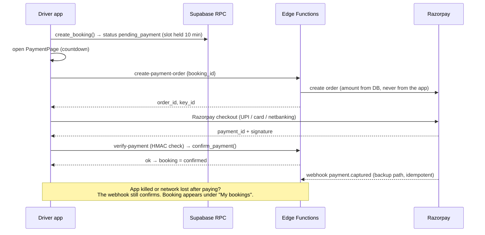

# 🔐 ChargeShare — Login/Signup, Payment Screen & Security Guide

Companion to the main `README.md`. This guide gives you **working, hardened** versions of:

1. **Login & signup** for the two roles (driver / host) with email-OTP verification, forgot-password, role enforcement, secure session storage and optional biometric app lock.
2. **Payment screen** (Razorpay) with hold-timer, retries, server-side verification, webhook, refunds and overstay-dues payment.
3. **Security hardening** of the database, Edge Functions and the Android build, plus an attack-test checklist.

> **Read section 1 first.** While making things "work properly" I found real bugs and security gaps in the first README. They are fixed here by one SQL migration (`0002`).

---

## Contents

1. [What was wrong in the first README (and the fix)](#1-what-was-wrong-in-the-first-readme)
2. [Supabase dashboard configuration](#2-supabase-dashboard-configuration)
3. [Migration `0002` — payments, refunds, privacy, hardening (SQL)](#3-migration-0002)
4. [Edge Functions (4) + cron](#4-edge-functions)
5. [Flutter setup & core files](#5-flutter-setup--core-files)
6. [Login, signup, verify, forgot password](#6-auth-screens)
7. [Biometric app lock](#7-biometric-app-lock)
8. [Payment screen](#8-payment-screen)
9. [Android hardening & release build](#9-android-hardening--release-build)
10. [Security model, threat table, attack tests](#10-security-model)
11. [End-to-end QA script](#11-end-to-end-qa-script)
12. [Troubleshooting](#12-troubleshooting)
13. [Go-live checklist](#13-go-live-checklist)

---

## 1. What was wrong in the first README

| # | Problem | Why it matters | Fix |
|---|---|---|---|
| 1 | **Signup then immediate login** | With "Confirm email" ON (required for production) login fails until verified. | New OTP verification flow (section 6). |
| 2 | **Login flicker on wrong tab** | `AuthGate` routed to the dashboard before the role check finished, then signed out. | `AuthController.guard()` + overlay; role checked before routing. |
| 3 | **Session stored unencrypted** | `supabase_flutter` defaults to SharedPreferences (plain text). | `flutter_secure_storage` (Android Keystore) as session storage. |
| 4 | **Exact home address visible to every driver** | `chargers` table was readable by all → address + exact coordinates leaked before booking. | Chargers readable by **host only**; drivers use RPCs returning *approximate* location; exact address only after the booking is paid. |
| 5 | **`public_profiles` view readable by anon / everyone** | User enumeration. | View restricted to related users; `anon` role stripped of all access. |
| 6 | **No refund processing** | `refund_amount` was set but money never went back. | `refunds` queue table + `process-refunds` Edge Function + cron. |
| 7 | **Webhook matched by booking id & could double-process** | Forgery / replay risk; slow confirmation. | Match by **order id**, signature verify, amount check, idempotent `confirm_payment()`; plus instant `verify-payment` function. |
| 8 | **Duplicate payment orders on double-tap** | Multiple orders per booking. | `create-payment-order` reuses the open order. |
| 9 | **Overstay dues had no way to be paid** | A driver with dues was blocked forever. | `kind = 'dues'` payments. |
| 10 | **Slot-hoarding attack** | A user could create unlimited `pending_payment` bookings and block every slot. | Trigger: max 3 pending and 10 upcoming per driver. |
| 11 | **Default Supabase grants** | `anon` and `authenticated` get broad table/function privileges by default; helper functions callable by anyone. | Explicit `revoke`/`grant` for every function and table. |
| 12 | **Payout without identity check** | Fraud. | Trigger: payouts need `kyc_status = 'verified'`. |
| 13 | **PostGIS functions not found** | `set search_path = public` fails if PostGIS lives in the `extensions` schema. | New functions use `search_path = public, extensions`. |
| 14 | **`.env` bundled as an asset** | Anything in the APK is extractable, and it tempts people to add secrets. | `--dart-define-from-file` (public keys only). |

---

## 2. Supabase dashboard configuration

Menu names shift slightly between dashboard versions; look for the setting by name.

### 2.1 Authentication settings

| Setting | Value | Why |
|---|---|---|
| Email provider | **Enabled** | Primary login |
| **Confirm email** | **ON** | Prevents fake/typo accounts |
| Secure email change | ON | Needs both emails to confirm |
| Secure password change | ON | Requires recent login to change password |
| Minimum password length | **8** (or more) | Baseline strength (app also enforces upper/lower/digit) |
| Leaked-password protection | ON (Pro plan feature) | Blocks known-breached passwords |
| Email OTP expiry | **600** seconds | Short-lived codes |
| Email OTP length | 6 | Matches the app |
| Anonymous sign-ins | **OFF** | Not used |
| Phone / unused OAuth providers | OFF | Smaller attack surface |
| JWT expiry | 3600 s | Default is fine |
| Refresh-token rotation | ON | Stolen refresh tokens become useless after use |
| Rate limits (Authentication → Rate Limits) | Keep defaults or lower | Brute-force protection |
| **Custom SMTP** | Configure (Resend, Brevo, SendGrid, …) | The built-in sender allows only a handful of emails per hour — signups will silently fail in testing |
| CAPTCHA (Attack Protection) | Enable before public launch (hCaptcha/Turnstile) | Stops signup bots. Needs a captcha widget in the app (`captchaToken` parameter) |

### 2.2 Email templates (OTP instead of links)

We use **6-digit codes** instead of magic links. No deep-link setup, works on every phone, harder to mis-handle.

**Authentication → Email Templates → "Confirm signup"**
```html
<h2>Verify your email</h2>
<p>Your ChargeShare verification code is:</p>
<h1 style="letter-spacing:6px">{{ .Token }}</h1>
<p>It expires in 10 minutes. If you didn't sign up, ignore this email.</p>
```

**"Reset Password"**
```html
<h2>Reset your password</h2>
<p>Your ChargeShare password reset code is:</p>
<h1 style="letter-spacing:6px">{{ .Token }}</h1>
<p>It expires in 10 minutes. If you didn't request this, you can ignore this email.</p>
```

### 2.3 Other

- **Database → Extensions:** enable `pg_net` (and `pg_cron`, `postgis`, `btree_gist` from the first README). `supabase_vault` is on by default.
- **Razorpay Dashboard:** Settings → Payment Capture → **Automatic**. Create a webhook pointing to `https://<PROJECT_REF>.supabase.co/functions/v1/payment-webhook` with events `payment.captured` and `order.paid`, and a secret you choose.
- **Storage:** bucket `charger-photos` (public read is fine for charger photos); bucket `kyc-documents` must be **private**.

---

## 3. Migration 0002

Run **after** the SQL from the main README. Save as `supabase/migrations/0002_auth_payments_security.sql`.

```sql
-- =====================================================================
-- 0002: payments (+dues), refunds queue, privacy, anti-abuse, hardening
-- =====================================================================
create extension if not exists pg_net;

-- ---------- 1. PAYMENTS: support dues, user ownership, partial refunds ----------
alter table payments alter column booking_id drop not null;
alter table payments add column if not exists user_id uuid references profiles(id);
alter table payments add column if not exists kind text not null default 'booking'
  check (kind in ('booking', 'dues'));
alter table payments add column if not exists refunded_amount numeric(10,2) not null default 0;
alter table payments add constraint payments_kind_booking_chk
  check (kind = 'dues' or booking_id is not null);

update payments p set user_id = b.driver_id
  from bookings b where b.id = p.booking_id and p.user_id is null;
create index if not exists payments_user_idx on payments (user_id, created_at desc);

drop policy if exists "own payments" on payments;
create policy "own payments" on payments for select to authenticated
  using (user_id = auth.uid());

-- ---------- 2. REFUNDS QUEUE ----------
create table if not exists refunds (
  id                 uuid primary key default gen_random_uuid(),
  payment_id         uuid not null references payments(id),
  booking_id         uuid references bookings(id),
  amount             numeric(10,2) not null check (amount > 0),
  reason             text,
  status             text not null default 'pending'
                     check (status in ('pending', 'processing', 'done', 'failed')),
  attempts           int not null default 0,
  provider_refund_id text,
  last_error         text,
  created_at         timestamptz not null default now(),
  processed_at       timestamptz
);
create index if not exists refunds_status_idx on refunds (status, created_at);
alter table refunds enable row level security;
create policy "own refunds" on refunds for select to authenticated
  using (exists (select 1 from payments p where p.id = payment_id and p.user_id = auth.uid()));
revoke insert, update, delete on refunds from authenticated;

-- queue a refund automatically whenever a booking asks for one
create or replace function queue_booking_refund() returns trigger
language plpgsql security definer set search_path = public as $$
declare v_pay payments;
begin
  if new.refund_status = 'pending' and old.refund_status is distinct from 'pending'
     and new.refund_amount > 0 then
    select * into v_pay from payments
     where booking_id = new.id and kind = 'booking' and status = 'paid'
     order by paid_at desc limit 1;
    if found then
      insert into refunds (payment_id, booking_id, amount, reason)
      values (v_pay.id, new.id, least(new.refund_amount, v_pay.amount), 'booking_' || new.status);
    end if;
  end if;
  return new;
end $$;

drop trigger if exists trg_queue_refund on bookings;
create trigger trg_queue_refund after update of refund_status on bookings
  for each row execute function queue_booking_refund();

-- claim a batch for processing (safe under concurrency)
create or replace function claim_refunds(p_limit int default 20)
returns setof refunds language plpgsql security definer set search_path = public as $$
begin
  return query
  update refunds r set status = 'processing', attempts = r.attempts + 1
   where r.id in (select id from refunds
                   where status = 'pending' and attempts < 5
                   order by created_at limit p_limit
                   for update skip locked)
  returning r.*;
end $$;

create or replace function finish_refund(p_refund uuid, p_ok boolean, p_provider_refund_id text, p_error text)
returns void language plpgsql security definer set search_path = public as $$
declare r refunds;
begin
  select * into r from refunds where id = p_refund for update;
  if not found then return; end if;
  if p_ok then
    update refunds set status = 'done', provider_refund_id = p_provider_refund_id,
           processed_at = now(), last_error = null where id = p_refund;
    update payments set refunded_amount = refunded_amount + r.amount where id = r.payment_id;
    update bookings set refund_status = 'done' where id = r.booking_id and refund_status <> 'done';
  else
    update refunds set status = case when attempts >= 5 then 'failed' else 'pending' end,
           last_error = left(p_error, 500) where id = p_refund;
  end if;
end $$;

-- ---------- 3. PAYMENT CONFIRMATION (idempotent; order-id based) ----------
drop function if exists confirm_booking_payment(uuid, text, numeric);

create or replace function confirm_payment(p_order_id text, p_payment_id text, p_amount numeric default null)
returns jsonb language plpgsql security definer set search_path = public as $$
declare pay payments;
begin
  select * into pay from payments where provider_order_id = p_order_id for update;
  if not found then return jsonb_build_object('ok', false, 'reason', 'unknown_order'); end if;
  if pay.status = 'paid' then return jsonb_build_object('ok', true, 'already', true); end if;
  if pay.status <> 'created' then return jsonb_build_object('ok', false, 'reason', pay.status::text); end if;
  if p_amount is not null and p_amount <> pay.amount then
    return jsonb_build_object('ok', false, 'reason', 'amount_mismatch');
  end if;

  update payments set status = 'paid', provider_payment_id = p_payment_id, paid_at = now()
   where id = pay.id;

  if pay.kind = 'dues' then
    update profiles set outstanding_due = greatest(outstanding_due - pay.amount, 0) where id = pay.user_id;
  else
    update bookings set status = 'confirmed' where id = pay.booking_id and status = 'pending_payment';
    if not found then
      -- paid after the hold expired / booking cancelled: refund everything
      insert into refunds (payment_id, booking_id, amount, reason)
      values (pay.id, pay.booking_id, pay.amount, 'paid_after_expiry');
      return jsonb_build_object('ok', false, 'reason', 'booking_expired_refund_queued');
    end if;
  end if;
  return jsonb_build_object('ok', true);
end $$;

-- ---------- 4. ANTI-ABUSE: slot hoarding & payout KYC ----------
create or replace function enforce_booking_limits() returns trigger
language plpgsql security definer set search_path = public as $$
begin
  if (select count(*) from bookings
       where driver_id = new.driver_id and status = 'pending_payment') >= 3 then
    raise exception 'too_many_pending';
  end if;
  if (select count(*) from bookings
       where driver_id = new.driver_id and status in ('confirmed', 'active')) >= 10 then
    raise exception 'too_many_upcoming';
  end if;
  return new;
end $$;
drop trigger if exists trg_booking_limits on bookings;
create trigger trg_booking_limits before insert on bookings
  for each row execute function enforce_booking_limits();

create or replace function require_kyc_for_payout() returns trigger
language plpgsql security definer set search_path = public as $$
begin
  if not exists (select 1 from profiles where id = new.host_id and kyc_status = 'verified') then
    raise exception 'kyc_required';
  end if;
  return new;
end $$;
drop trigger if exists trg_payout_kyc on payouts;
create trigger trg_payout_kyc before insert on payouts
  for each row execute function require_kyc_for_payout();

-- ---------- 5. PRIVACY: no exact address/coordinates before a paid booking ----------
alter table chargers add column if not exists area_label text;   -- e.g. "Indiranagar, Bengaluru"

drop policy if exists "read chargers" on chargers;
create policy "host reads own chargers" on chargers for select to authenticated
  using (host_id = auth.uid());
grant insert (area_label) on chargers to authenticated;
grant update (area_label) on chargers to authenticated;

drop function if exists nearby_chargers(double precision, double precision, integer,
                                        timestamptz, timestamptz, connector_type);

create or replace function nearby_chargers(
  p_lat double precision, p_lng double precision, p_radius_m integer default 5000,
  p_start timestamptz default null, p_end timestamptz default null,
  p_connector connector_type default null
) returns table (
  id uuid, title text, area_label text, lat double precision, lng double precision,
  distance_m double precision, tier_code text, power_kw numeric, price_per_hour numeric,
  connector connector_type, rating_avg numeric, rating_count int, host_name text
) language sql stable security definer set search_path = public, extensions as $$
  select c.id, c.title, c.area_label,
         ST_Y(ST_SnapToGrid(c.location::geometry, 0.002)),     -- ~200 m grid: approximate pin only
         ST_X(ST_SnapToGrid(c.location::geometry, 0.002)),
         round(ST_Distance(c.location, ST_SetSRID(ST_MakePoint(p_lng, p_lat), 4326)::geography) / 100) * 100,
         c.tier_code, t.power_kw, t.price_per_hour, c.connector,
         c.rating_avg, c.rating_count, p.full_name
  from chargers c
  join charger_tiers t on t.code = c.tier_code
  join profiles p on p.id = c.host_id
  where c.status = 'active' and not c.is_paused
    and ST_DWithin(c.location, ST_SetSRID(ST_MakePoint(p_lng, p_lat), 4326)::geography,
                   least(p_radius_m, 25000))
    and (p_connector is null or c.connector = p_connector)
    and (p_start is null or p_end is null or (
          is_within_availability(c.id, p_start, p_end)
          and not exists (select 1 from bookings b
                           where b.charger_id = c.id
                             and b.status in ('pending_payment','confirmed','active','completed')
                             and b.during && tstzrange(p_start, p_end))
          and not exists (select 1 from charger_blocks k
                           where k.charger_id = c.id and k.during && tstzrange(p_start, p_end))))
  order by 6
  limit 50;
$$;

create or replace function get_charger_public(p_id uuid)
returns table (
  id uuid, title text, description text, area_label text, lat double precision, lng double precision,
  tier_code text, power_kw numeric, price_per_hour numeric, connector connector_type,
  photos text[], rules text, rating_avg numeric, rating_count int, host_name text
) language sql stable security definer set search_path = public, extensions as $$
  select c.id, c.title, c.description, c.area_label,
         ST_Y(ST_SnapToGrid(c.location::geometry, 0.002)), ST_X(ST_SnapToGrid(c.location::geometry, 0.002)),
         c.tier_code, t.power_kw, t.price_per_hour, c.connector, c.photos, c.rules,
         c.rating_avg, c.rating_count, p.full_name
  from chargers c
  join charger_tiers t on t.code = c.tier_code
  join profiles p on p.id = c.host_id
  where c.id = p_id and c.status = 'active' and not c.is_paused;
$$;

-- exact address + host phone: ONLY for the driver of a paid (confirmed/active) booking
create or replace function get_booking_location(p_booking uuid)
returns table (address text, lat double precision, lng double precision, host_name text, host_phone text)
language sql stable security definer set search_path = public, extensions as $$
  select c.address, ST_Y(c.location::geometry), ST_X(c.location::geometry), p.full_name, p.phone
  from bookings b
  join chargers c on c.id = b.charger_id
  join profiles p on p.id = c.host_id
  where b.id = p_booking and b.driver_id = auth.uid() and b.status in ('confirmed', 'active');
$$;

-- driver's own bookings with charger info (address only once paid)
create or replace view driver_bookings as
select b.id, b.charger_id, c.title as charger_title, c.area_label, b.status,
       lower(b.during) as start_at, upper(b.during) as end_at, b.hours,
       b.base_amount, b.driver_fee, b.total_amount, b.final_base_amount,
       b.overstay_amount, b.refund_amount, b.refund_status, b.started_at, b.ended_at,
       b.created_at,
       case when b.status in ('confirmed', 'active') then c.address end as address
from bookings b join chargers c on c.id = b.charger_id
where b.driver_id = auth.uid();

-- profiles: only people you actually interact with (or active hosts) are visible
create or replace view public_profiles as
select p.id, p.full_name, p.avatar_url, p.rating_avg, p.rating_count, p.role
from profiles p
where p.id = auth.uid()
   or exists (select 1 from chargers c where c.host_id = p.id and c.status = 'active')
   or exists (select 1 from bookings b join chargers c on c.id = b.charger_id
               where (b.driver_id = p.id and c.host_id = auth.uid())
                  or (c.host_id = p.id and b.driver_id = auth.uid()));

-- NOTE: Supabase's Security Advisor flags these two views as "security definer views".
-- That is intentional: each one filters by auth.uid() itself.

-- ---------- 6. PRIVILEGES: deny by default, grant explicitly ----------
-- 6a. anon (not logged in) gets nothing in public
revoke all on all tables    in schema public from anon;
revoke all on all functions in schema public from anon;
alter default privileges in schema public revoke all on tables    from anon;
alter default privileges in schema public revoke all on functions from anon;

-- 6b. logged-in users: no TRUNCATE / REFERENCES / TRIGGER anywhere
revoke truncate, references, trigger on all tables in schema public from authenticated;

-- 6c. views: authenticated only
revoke all on public_profiles, driver_bookings from anon, public;
grant select on public_profiles, driver_bookings to authenticated;

-- 6d. internal functions: nobody on the API may call them
revoke execute on function
  setting_num(text),
  is_within_availability(uuid, timestamptz, timestamptz),
  handle_new_user(),
  create_charger_secret(),
  queue_booking_refund(),
  enforce_booking_limits(),
  require_kyc_for_payout(),
  expire_pending_bookings(),
  mark_no_shows(),
  settle_due_bookings(),
  claim_refunds(int),
  finish_refund(uuid, boolean, text, text),
  confirm_payment(text, text, numeric)
from public, anon, authenticated;

grant execute on function
  claim_refunds(int),
  finish_refund(uuid, boolean, text, text),
  confirm_payment(text, text, numeric)
to service_role;

-- 6e. client RPCs: logged-in users only
revoke execute on function
  quote_booking(uuid, timestamptz, timestamptz),
  nearby_chargers(double precision, double precision, integer, timestamptz, timestamptz, connector_type),
  get_charger_public(uuid),
  get_booking_location(uuid),
  get_busy_slots(uuid, timestamptz, timestamptz),
  create_booking(uuid, uuid, timestamptz, timestamptz),
  start_session(uuid, text),
  end_session(uuid),
  cancel_booking(uuid, text),
  raise_dispute(uuid, text),
  submit_review(uuid, integer, text),
  request_payout(numeric, text)
from public, anon;

grant execute on function
  quote_booking(uuid, timestamptz, timestamptz),
  nearby_chargers(double precision, double precision, integer, timestamptz, timestamptz, connector_type),
  get_charger_public(uuid),
  get_booking_location(uuid),
  get_busy_slots(uuid, timestamptz, timestamptz),
  create_booking(uuid, uuid, timestamptz, timestamptz),
  start_session(uuid, text),
  end_session(uuid),
  cancel_booking(uuid, text),
  raise_dispute(uuid, text),
  submit_review(uuid, integer, text),
  request_payout(numeric, text)
to authenticated;

-- ---------- 7. CRON: refunds (calls the Edge Function with a shared secret) ----------
-- Put a long random string here, and the SAME value in `supabase secrets set CRON_SECRET=...`
select vault.create_secret('<LONG_RANDOM_STRING>', 'cron_secret');

select cron.schedule('process-refunds', '*/5 * * * *', $$
  select net.http_post(
    url     := 'https://<PROJECT_REF>.supabase.co/functions/v1/process-refunds',
    headers := jsonb_build_object(
                 'Content-Type', 'application/json',
                 'x-cron-secret', (select decrypted_secret from vault.decrypted_secrets where name = 'cron_secret')),
    body    := '{}'::jsonb
  );
$$);
```

**Host listing change:** when a host adds a charger, ask for an `area_label` (neighbourhood, city) and pass it in the insert. Drivers only ever see this label and an approximate pin until their booking is paid.

---

## 4. Edge Functions

```bash
supabase functions new create-payment-order
supabase functions new verify-payment
supabase functions new payment-webhook
supabase functions new process-refunds

supabase secrets set RAZORPAY_KEY_ID=rzp_test_xxx RAZORPAY_KEY_SECRET=xxx \
                     RAZORPAY_WEBHOOK_SECRET=xxx CRON_SECRET=<same value as in vault>

supabase functions deploy create-payment-order          # JWT required (default)
supabase functions deploy verify-payment                # JWT required (default)
supabase functions deploy payment-webhook  --no-verify-jwt   # called by Razorpay; protected by signature
supabase functions deploy process-refunds  --no-verify-jwt   # called by cron; protected by x-cron-secret
```

`SUPABASE_URL`, `SUPABASE_ANON_KEY`, `SUPABASE_SERVICE_ROLE_KEY` are injected automatically. **The service-role key lives only in Edge Functions — never in the app.**

### `supabase/functions/_shared/utils.ts`

```ts
import { createClient } from 'npm:@supabase/supabase-js@2';

export const corsHeaders = {
  'Access-Control-Allow-Origin': '*',
  'Access-Control-Allow-Headers': 'authorization, x-client-info, apikey, content-type',
};

export const json = (body: unknown, status = 200) =>
  new Response(JSON.stringify(body), { status, headers: { ...corsHeaders, 'Content-Type': 'application/json' } });

export const adminClient = () =>
  createClient(Deno.env.get('SUPABASE_URL')!, Deno.env.get('SUPABASE_SERVICE_ROLE_KEY')!,
    { auth: { persistSession: false } });

export const userClient = (authHeader: string) =>
  createClient(Deno.env.get('SUPABASE_URL')!, Deno.env.get('SUPABASE_ANON_KEY')!,
    { global: { headers: { Authorization: authHeader } }, auth: { persistSession: false } });

export const razorpayAuth = () =>
  'Basic ' + btoa(`${Deno.env.get('RAZORPAY_KEY_ID')}:${Deno.env.get('RAZORPAY_KEY_SECRET')}`);

export async function hmacHex(secret: string, message: string): Promise<string> {
  const key = await crypto.subtle.importKey('raw', new TextEncoder().encode(secret),
    { name: 'HMAC', hash: 'SHA-256' }, false, ['sign']);
  const sig = await crypto.subtle.sign('HMAC', key, new TextEncoder().encode(message));
  return [...new Uint8Array(sig)].map((b) => b.toString(16).padStart(2, '0')).join('');
}

/** constant-time string comparison (prevents timing attacks on signatures/secrets) */
export function safeEqual(a: string, b: string): boolean {
  if (a.length !== b.length) return false;
  let r = 0;
  for (let i = 0; i < a.length; i++) r |= a.charCodeAt(i) ^ b.charCodeAt(i);
  return r === 0;
}
```

### `create-payment-order/index.ts`

```ts
import { adminClient, userClient, json, corsHeaders, razorpayAuth } from '../_shared/utils.ts';

const UUID = /^[0-9a-f]{8}-[0-9a-f]{4}-[0-9a-f]{4}-[0-9a-f]{4}-[0-9a-f]{12}$/i;

Deno.serve(async (req) => {
  if (req.method === 'OPTIONS') return new Response('ok', { headers: corsHeaders });
  try {
    const authHeader = req.headers.get('Authorization');
    if (!authHeader) return json({ error: 'unauthorized' }, 401);
    const uc = userClient(authHeader);
    const { data: { user } } = await uc.auth.getUser();
    if (!user) return json({ error: 'unauthorized' }, 401);

    const body = await req.json().catch(() => ({}));
    const admin = adminClient();

    let kind: 'booking' | 'dues';
    let amount: number;
    let bookingId: string | null = null;

    if (body.kind === 'dues') {
      kind = 'dues';
      const { data: prof } = await uc.from('profiles').select('outstanding_due').eq('id', user.id).single();
      amount = Number(prof?.outstanding_due ?? 0);
      if (!(amount > 0)) return json({ error: 'no_dues' }, 400);
    } else {
      kind = 'booking';
      const bid = String(body.booking_id ?? '');
      if (!UUID.test(bid)) return json({ error: 'invalid_booking' }, 400);
      // RLS guarantees the caller can only read their own booking
      const { data: b } = await uc.from('bookings')
        .select('id, total_amount, status, created_at').eq('id', bid).single();
      if (!b || b.status !== 'pending_payment') return json({ error: 'booking_not_payable' }, 400);

      const { data: ttlRow } = await admin.from('platform_settings').select('value')
        .eq('key', 'pending_payment_ttl_minutes').single();
      const ttlMin = Number(ttlRow?.value ?? 10);
      if (Date.now() > new Date(b.created_at).getTime() + ttlMin * 60_000) {
        return json({ error: 'booking_expired' }, 400);
      }
      bookingId = b.id;
      amount = Number(b.total_amount);
    }

    // Reuse an open order (double-tap / retry) instead of creating duplicates
    let q = admin.from('payments').select('provider_order_id')
      .eq('user_id', user.id).eq('kind', kind).eq('status', 'created').eq('amount', amount);
    if (bookingId) q = q.eq('booking_id', bookingId);
    const { data: existing } = await q.order('created_at', { ascending: false }).limit(1).maybeSingle();

    const amountPaise = Math.round(amount * 100);
    if (existing?.provider_order_id) {
      return json({ order_id: existing.provider_order_id, amount: amountPaise, currency: 'INR',
                    key_id: Deno.env.get('RAZORPAY_KEY_ID') });
    }

    const receipt = `${kind}-${(bookingId ?? user.id).slice(0, 8)}-${Date.now()}`;
    const rz = await fetch('https://api.razorpay.com/v1/orders', {
      method: 'POST',
      headers: { 'Content-Type': 'application/json', Authorization: razorpayAuth() },
      body: JSON.stringify({
        amount: amountPaise, currency: 'INR', receipt,
        notes: { kind, booking_id: bookingId ?? '', user_id: user.id },
      }),
    });
    const order = await rz.json();
    if (!rz.ok) { console.error('razorpay order error', order?.error?.code); return json({ error: 'payment_provider_error' }, 502); }

    const { error: insErr } = await admin.from('payments').insert({
      booking_id: bookingId, user_id: user.id, kind, provider: 'razorpay',
      provider_order_id: order.id, amount, currency: 'INR',
    });
    if (insErr) { console.error(insErr.message); return json({ error: 'server_error' }, 500); }

    return json({ order_id: order.id, amount: amountPaise, currency: 'INR',
                  key_id: Deno.env.get('RAZORPAY_KEY_ID') });
  } catch (e) {
    console.error('create-payment-order', e);
    return json({ error: 'server_error' }, 500);
  }
});
```

### `verify-payment/index.ts` (instant confirmation after checkout)

```ts
import { adminClient, userClient, json, corsHeaders, hmacHex, safeEqual } from '../_shared/utils.ts';

Deno.serve(async (req) => {
  if (req.method === 'OPTIONS') return new Response('ok', { headers: corsHeaders });
  try {
    const authHeader = req.headers.get('Authorization');
    if (!authHeader) return json({ error: 'unauthorized' }, 401);
    const uc = userClient(authHeader);
    const { data: { user } } = await uc.auth.getUser();
    if (!user) return json({ error: 'unauthorized' }, 401);

    const { razorpay_order_id, razorpay_payment_id, razorpay_signature } = await req.json();
    if (![razorpay_order_id, razorpay_payment_id, razorpay_signature].every((v) => typeof v === 'string' && v.length > 5)) {
      return json({ error: 'invalid_input' }, 400);
    }

    // 1) the order must belong to the caller (RLS: payments.user_id = auth.uid())
    const { data: pay } = await uc.from('payments').select('id, amount')
      .eq('provider_order_id', razorpay_order_id).maybeSingle();
    if (!pay) return json({ error: 'unknown_order' }, 404);

    // 2) cryptographic proof that Razorpay captured this payment for this order
    const expected = await hmacHex(Deno.env.get('RAZORPAY_KEY_SECRET')!, `${razorpay_order_id}|${razorpay_payment_id}`);
    if (!safeEqual(expected, razorpay_signature)) return json({ error: 'bad_signature' }, 400);

    // 3) idempotent state change (the webhook may do the same later — that's fine)
    const { data, error } = await adminClient().rpc('confirm_payment', {
      p_order_id: razorpay_order_id, p_payment_id: razorpay_payment_id, p_amount: null,
    });
    if (error) { console.error(error.message); return json({ error: 'server_error' }, 500); }
    return json(data);
  } catch (e) {
    console.error('verify-payment', e);
    return json({ error: 'server_error' }, 500);
  }
});
```

### `payment-webhook/index.ts`

```ts
import { adminClient, hmacHex, safeEqual } from '../_shared/utils.ts';

Deno.serve(async (req) => {
  const raw = await req.text();
  const signature = req.headers.get('x-razorpay-signature') ?? '';
  const expected = await hmacHex(Deno.env.get('RAZORPAY_WEBHOOK_SECRET')!, raw);
  if (!safeEqual(signature, expected)) return new Response('bad signature', { status: 401 });

  const event = JSON.parse(raw);
  if (event.event === 'payment.captured' || event.event === 'order.paid') {
    const p = event.payload?.payment?.entity;
    if (p?.order_id && p?.id) {
      const { data, error } = await adminClient().rpc('confirm_payment', {
        p_order_id: p.order_id, p_payment_id: p.id, p_amount: p.amount / 100,
      });
      if (error) return new Response('retry', { status: 500 });          // Razorpay retries
      if (data && data.ok === false) console.warn('webhook not applied:', data.reason, p.order_id);
    }
  }
  return new Response('ok');                                             // always 200 for handled/ignored events
});
```

### `process-refunds/index.ts`

```ts
import { adminClient, json, razorpayAuth, safeEqual } from '../_shared/utils.ts';

Deno.serve(async (req) => {
  const secret = req.headers.get('x-cron-secret') ?? '';
  if (!safeEqual(secret, Deno.env.get('CRON_SECRET') ?? '')) return json({ error: 'forbidden' }, 403);

  const admin = adminClient();
  const { data: batch, error } = await admin.rpc('claim_refunds', { p_limit: 20 });
  if (error) return json({ error: error.message }, 500);

  let done = 0, failed = 0;
  for (const r of batch ?? []) {
    try {
      const { data: pay } = await admin.from('payments').select('provider_payment_id').eq('id', r.payment_id).single();
      if (!pay?.provider_payment_id) throw new Error('payment_id_missing');

      const res = await fetch(`https://api.razorpay.com/v1/payments/${pay.provider_payment_id}/refund`, {
        method: 'POST',
        headers: { 'Content-Type': 'application/json', Authorization: razorpayAuth() },
        body: JSON.stringify({
          amount: Math.round(Number(r.amount) * 100), speed: 'normal', receipt: r.id,
          notes: { refund_row: r.id, reason: r.reason ?? '' },
        }),
      });
      const out = await res.json();
      if (!res.ok) throw new Error(out?.error?.description ?? 'refund_failed');

      await admin.rpc('finish_refund', { p_refund: r.id, p_ok: true, p_provider_refund_id: out.id, p_error: null });
      done++;
    } catch (e) {
      await admin.rpc('finish_refund', { p_refund: r.id, p_ok: false, p_provider_refund_id: null, p_error: String(e.message ?? e) });
      failed++;
    }
  }
  return json({ done, failed });
});
```

> **Stuck refunds:** if the function dies mid-run a row can stay `processing`. Check weekly: `select * from refunds where status in ('processing','failed');` — verify in the Razorpay dashboard before resetting a row to `pending` (to avoid refunding twice).

---

## 5. Flutter setup & core files

```bash
flutter pub add supabase_flutter flutter_secure_storage razorpay_flutter intl
flutter pub add local_auth:^2.3.0       # the code below uses the 2.x API
# plus the packages from the main README (flutter_map, latlong2, geolocator, mobile_scanner, qr_flutter, image_picker)
# you no longer need flutter_dotenv
```

Create `env.json` (**add to `.gitignore`**) — **public values only**:

```json
{
  "SUPABASE_URL": "https://YOUR-PROJECT-REF.supabase.co",
  "SUPABASE_ANON_KEY": "YOUR-ANON-OR-PUBLISHABLE-KEY"
}
```

Run: `flutter run --dart-define-from-file=env.json`

> The anon/publishable key is *designed* to be public — your RLS and function grants are what protect data. Never put the service-role/secret key, Razorpay **key secret**, or webhook secret in the app.

Android minimum SDK: `minSdkVersion 23` (required by `flutter_secure_storage`).

### `lib/core/config.dart`

```dart
class Env {
  static const supabaseUrl = String.fromEnvironment('SUPABASE_URL');
  static const supabaseAnonKey = String.fromEnvironment('SUPABASE_ANON_KEY');
}
```

### `lib/core/supabase.dart`

```dart
import 'package:supabase_flutter/supabase_flutter.dart';
SupabaseClient get supabase => Supabase.instance.client;
```

### `lib/core/secure_storage.dart` — encrypted session

```dart
import 'package:flutter_secure_storage/flutter_secure_storage.dart';
import 'package:supabase_flutter/supabase_flutter.dart';

const _storage = FlutterSecureStorage();

/// Stores the Supabase session in the Android Keystore-backed secure storage
/// instead of plain SharedPreferences.
class SecureLocalStorage extends LocalStorage {
  SecureLocalStorage()
      : super(
          initialize: () async {},
          hasAccessToken: () => _storage.containsKey(key: supabasePersistSessionKey),
          accessToken: () => _storage.read(key: supabasePersistSessionKey),
          removePersistedSession: () => _storage.delete(key: supabasePersistSessionKey),
          persistSession: (value) => _storage.write(key: supabasePersistSessionKey, value: value),
        );
}
```

### `lib/core/secure_screen.dart` — block screenshots on sensitive screens

```dart
import 'package:flutter/services.dart';

/// Toggles Android FLAG_SECURE (no screenshots / hidden in recent-apps preview).
class SecureScreen {
  static const _ch = MethodChannel('chargeshare/secure');
  static Future<void> enable() async { try { await _ch.invokeMethod('enable'); } catch (_) {} }
  static Future<void> disable() async { try { await _ch.invokeMethod('disable'); } catch (_) {} }
}
```
(The Kotlin side is in [section 9](#9-android-hardening--release-build).)

### `lib/core/validators.dart`

```dart
class Validators {
  static final _email = RegExp(r'^[^\s@]+@[^\s@]+\.[^\s@]{2,}$');

  static String? email(String? v) {
    final s = (v ?? '').trim();
    if (s.isEmpty) return 'Enter your email';
    if (s.length > 254 || !_email.hasMatch(s)) return 'Enter a valid email';
    return null;
  }

  static String? password(String? v) {
    final s = v ?? '';
    if (s.length < 8) return 'Use at least 8 characters';
    if (s.length > 72) return 'Password is too long';
    if (!RegExp(r'[a-z]').hasMatch(s)) return 'Add a lowercase letter';
    if (!RegExp(r'[A-Z]').hasMatch(s)) return 'Add an uppercase letter';
    if (!RegExp(r'\d').hasMatch(s)) return 'Add a number';
    return null;
  }

  static String? name(String? v) {
    final s = (v ?? '').trim();
    if (s.length < 2) return 'Enter your full name';
    if (s.length > 60) return 'Name is too long';
    return null;
  }

  static String? otp(String? v) =>
      RegExp(r'^\d{6}$').hasMatch((v ?? '').trim()) ? null : 'Enter the 6-digit code';
}
```

### `lib/core/errors.dart` — never show raw server errors

```dart
import 'package:supabase_flutter/supabase_flutter.dart';

class RoleMismatch implements Exception {
  RoleMismatch(this.actual, this.expected);
  final String actual, expected;
  String get message => actual == 'unknown'
      ? 'Account not found. Please sign up.'
      : 'This is a $actual account. Switch to the "${actual == 'host' ? 'I own a charger' : 'I need to charge'}" tab to log in.';
}

String friendlyError(Object e) {
  if (e is RoleMismatch) return e.message;

  String raw;
  if (e is AuthException) {
    raw = e.message;
  } else if (e is PostgrestException) {
    raw = e.message;
  } else if (e is FunctionException) {
    final d = e.details;
    raw = (d is Map && d['error'] != null) ? d['error'].toString() : (e.reasonPhrase ?? '');
  } else {
    raw = e.toString();
  }
  final m = raw.toLowerCase();

  const map = <String, String>{
    'invalid login credentials': 'Incorrect email or password.',
    'email not confirmed': 'Please verify your email first.',
    'already registered': 'An account with this email already exists. Try logging in.',
    'token has expired or is invalid': 'That code is wrong or has expired. Request a new one.',
    'rate limit': 'Too many attempts. Please wait a minute and try again.',
    'over_email_send_rate_limit': 'Too many emails requested. Please wait a few minutes.',
    'new password should be different': 'Choose a password you have not used before.',
    'slot_taken': 'Someone just booked this slot. Please pick another time.',
    'outside_availability': 'The host is not available at that time.',
    'host_blocked': 'The host has blocked that time.',
    'outstanding_dues': 'Please clear your pending dues before booking.',
    'too_many_pending': 'You have several unpaid bookings. Pay or cancel them first.',
    'too_many_upcoming': 'You have too many upcoming bookings.',
    'booking_expired': 'The 10-minute hold expired. Please book again.',
    'booking_not_payable': 'This booking can no longer be paid.',
    'wrong_code': 'That QR code does not match this charger.',
    'outside_checkin_window': 'Check-in opens 15 minutes before your slot.',
    'kyc_required': 'Please complete identity verification before withdrawing.',
    'permission denied': 'You do not have permission to do that.',
    'network': 'Network problem. Check your connection and try again.',
    'socketexception': 'Network problem. Check your connection and try again.',
  };
  for (final entry in map.entries) {
    if (m.contains(entry.key)) return entry.value;
  }
  return 'Something went wrong. Please try again.';
}
```

### `lib/core/utils.dart`

```dart
import 'package:intl/intl.dart';

final money = NumberFormat.currency(locale: 'en_IN', symbol: '₹', decimalDigits: 2); // change for your currency
final dateTimeFmt = DateFormat('EEE, d MMM • h:mm a');
String fmtRange(DateTime a, DateTime b) =>
    '${dateTimeFmt.format(a.toLocal())} – ${DateFormat('h:mm a').format(b.toLocal())}';
```

### `lib/main.dart`

```dart
import 'package:flutter/material.dart';
import 'package:supabase_flutter/supabase_flutter.dart';
import 'core/config.dart';
import 'core/secure_storage.dart';
import 'features/auth/auth_gate.dart';

Future<void> main() async {
  WidgetsFlutterBinding.ensureInitialized();
  assert(Env.supabaseUrl.isNotEmpty && Env.supabaseAnonKey.isNotEmpty,
      'Run with: flutter run --dart-define-from-file=env.json');
  await Supabase.initialize(
    url: Env.supabaseUrl,
    anonKey: Env.supabaseAnonKey,
    authOptions: FlutterAuthClientOptions(localStorage: SecureLocalStorage()),
  );
  runApp(const ChargeShareApp());
}

class ChargeShareApp extends StatelessWidget {
  const ChargeShareApp({super.key});
  @override
  Widget build(BuildContext context) => MaterialApp(
        title: 'ChargeShare',
        debugShowCheckedModeBanner: false,
        theme: ThemeData(colorSchemeSeed: Colors.green, useMaterial3: true),
        home: const AuthGate(),
      );
}
```

---

## 6. Auth screens

### `lib/features/auth/auth_controller.dart`

```dart
import 'package:flutter/foundation.dart';

/// Tells AuthGate "an auth operation is in progress — don't route yet".
class AuthController extends ChangeNotifier {
  AuthController._();
  static final instance = AuthController._();

  int _busy = 0;
  bool get verifying => _busy > 0;

  Future<T> guard<T>(Future<T> Function() fn) async {
    _busy++;
    notifyListeners();
    try {
      return await fn();
    } finally {
      _busy--;
      notifyListeners();
    }
  }
}
```

### `lib/data/auth_repo.dart`

```dart
import 'package:supabase_flutter/supabase_flutter.dart';
import '../core/errors.dart';
import '../core/supabase.dart';
import '../features/auth/auth_controller.dart';

class AuthRepo {
  GoTrueClient get _auth => supabase.auth;
  String _e(String s) => s.trim().toLowerCase();

  /// Creates the account. With "Confirm email" ON no session exists until [verifySignup].
  Future<void> signUp({
    required String email, required String password,
    required String name, required String role, // 'driver' | 'host'
  }) async {
    assert(role == 'driver' || role == 'host');
    await _auth.signUp(
      email: _e(email), password: password,
      data: {'role': role, 'full_name': name.trim()},   // consumed by the handle_new_user trigger
    );
  }

  Future<void> verifySignup({required String email, required String code}) async {
    await _auth.verifyOTP(email: _e(email), token: code.trim(), type: OtpType.signup);
  }

  Future<void> resendSignupCode(String email) =>
      _auth.resend(type: OtpType.signup, email: _e(email));

  /// Logs in and makes sure the account type matches the chosen login tab.
  Future<String> signIn({
    required String email, required String password, required String expectedRole,
  }) {
    return AuthController.instance.guard(() async {
      await _auth.signInWithPassword(email: _e(email), password: password);
      final role = await fetchRole();
      if (role != expectedRole) {
        await _auth.signOut();
        throw RoleMismatch(role ?? 'unknown', expectedRole);
      }
      return expectedRole;
    });
  }

  Future<String?> fetchRole() async {
    final u = _auth.currentUser;
    if (u == null) return null;
    final p = await supabase.from('profiles').select('role').eq('id', u.id).maybeSingle();
    return p?['role'] as String?;
  }

  /// Sends a 6-digit code. Always behaves the same whether or not the email exists.
  Future<void> sendResetCode(String email) => _auth.resetPasswordForEmail(_e(email));

  Future<void> resetPassword({
    required String email, required String code, required String newPassword,
  }) {
    return AuthController.instance.guard(() async {
      await _auth.verifyOTP(email: _e(email), token: code.trim(), type: OtpType.recovery);
      await _auth.updateUser(UserAttributes(password: newPassword));
      await _auth.signOut();             // force a fresh login with the new password
    });
  }

  /// Change password while logged in (re-authenticates first).
  Future<void> changePassword({required String current, required String next}) async {
    final email = _auth.currentUser?.email;
    if (email == null) throw Exception('not_logged_in');
    await _auth.signInWithPassword(email: email, password: current);
    await _auth.updateUser(UserAttributes(password: next));
  }

  Future<void> signOut() => _auth.signOut();
}
```

### `lib/features/auth/auth_gate.dart`

```dart
import 'dart:async';
import 'package:flutter/material.dart';
import 'package:supabase_flutter/supabase_flutter.dart';
import '../../core/supabase.dart';
import '../../data/auth_repo.dart';
import '../driver/home_map_page.dart';   // DriverHomePage
import '../host/host_home_page.dart';    // HostHomePage
import 'app_lock.dart';
import 'auth_controller.dart';
import 'login_page.dart';

class AuthGate extends StatefulWidget {
  const AuthGate({super.key});
  @override
  State<AuthGate> createState() => _AuthGateState();
}

class _AuthGateState extends State<AuthGate> {
  StreamSubscription<AuthState>? _sub;
  String? _role;
  String? _roleUserId;
  bool _loadingRole = false;

  @override
  void initState() {
    super.initState();
    _sub = supabase.auth.onAuthStateChange.listen((_) => _syncRole());
    _syncRole();
  }

  @override
  void dispose() { _sub?.cancel(); super.dispose(); }

  Future<void> _syncRole() async {
    final user = supabase.auth.currentUser;
    if (user == null) {
      if (mounted) setState(() { _role = null; _roleUserId = null; });
      return;
    }
    if (_roleUserId == user.id && _role != null) return;
    if (mounted) setState(() => _loadingRole = true);
    try {
      final r = await AuthRepo().fetchRole();
      if (r == null) { await supabase.auth.signOut(); return; }
      if (mounted) setState(() { _role = r; _roleUserId = user.id; });
    } catch (_) {
      await supabase.auth.signOut();
    } finally {
      if (mounted) setState(() => _loadingRole = false);
    }
  }

  @override
  Widget build(BuildContext context) {
    return ListenableBuilder(
      listenable: AuthController.instance,
      builder: (context, _) {
        final verifying = AuthController.instance.verifying;
        final signedIn = supabase.auth.currentSession != null;

        Widget body;
        if (!signedIn || verifying) {
          body = const LoginPage();                       // stays mounted while verifying
        } else if (_loadingRole || _role == null) {
          body = const Scaffold(body: Center(child: CircularProgressIndicator()));
        } else {
          body = AppLock(child: _role == 'host' ? const HostHomePage() : const DriverHomePage());
        }
        return Stack(children: [
          body,
          if (verifying)
            const Positioned.fill(
              child: ColoredBox(color: Colors.black38, child: Center(child: CircularProgressIndicator())),
            ),
        ]);
      },
    );
  }
}
```

### `lib/features/auth/login_page.dart` — two logins in one screen

```dart
import 'package:flutter/material.dart';
import '../../core/errors.dart';
import '../../core/secure_screen.dart';
import '../../core/validators.dart';
import '../../data/auth_repo.dart';
import 'forgot_password_page.dart';
import 'signup_page.dart';
import 'verify_email_page.dart';

class LoginPage extends StatefulWidget {
  const LoginPage({super.key});
  @override
  State<LoginPage> createState() => _LoginPageState();
}

class _LoginPageState extends State<LoginPage> with SingleTickerProviderStateMixin {
  final _form = GlobalKey<FormState>();
  late final TabController _tabs = TabController(length: 2, vsync: this)
    ..addListener(() { if (!_tabs.indexIsChanging && mounted) setState(() {}); });
  final _email = TextEditingController();
  final _pass = TextEditingController();
  bool _hide = true, _busy = false;
  int _fails = 0;
  DateTime? _lockedUntil;

  String get _role => _tabs.index == 0 ? 'driver' : 'host';

  @override
  void initState() { super.initState(); SecureScreen.enable(); }

  @override
  void dispose() {
    SecureScreen.disable();
    _tabs.dispose(); _email.dispose(); _pass.dispose();
    super.dispose();
  }

  void _toast(String m) {
    if (!mounted) return;
    ScaffoldMessenger.of(context).showSnackBar(SnackBar(content: Text(m)));
  }

  Future<void> _login() async {
    if (_lockedUntil != null && DateTime.now().isBefore(_lockedUntil!)) {
      return _toast('Too many failed attempts. Please wait 30 seconds.');
    }
    if (!_form.currentState!.validate()) return;
    setState(() => _busy = true);
    try {
      await AuthRepo().signIn(email: _email.text, password: _pass.text, expectedRole: _role);
      _fails = 0;                                  // AuthGate now routes to the right home
    } catch (e) {
      final notConfirmed = e.toString().toLowerCase().contains('not confirmed');
      if (notConfirmed && mounted) {
        _toast('Please verify your email to continue.');
        Navigator.push(context, MaterialPageRoute(
          builder: (_) => VerifyEmailPage(email: _email.text.trim(), sendCodeOnOpen: true)));
      } else {
        if (++_fails >= 5) { _lockedUntil = DateTime.now().add(const Duration(seconds: 30)); _fails = 0; }
        _toast(friendlyError(e));
      }
    } finally {
      if (mounted) setState(() => _busy = false);
    }
  }

  @override
  Widget build(BuildContext context) {
    final isHost = _role == 'host';
    return Scaffold(
      appBar: AppBar(
        title: const Text('ChargeShare'),
        bottom: TabBar(controller: _tabs, tabs: const [
          Tab(icon: Icon(Icons.directions_car), text: 'I need to charge'),
          Tab(icon: Icon(Icons.home), text: 'I own a charger'),
        ]),
      ),
      body: SafeArea(
        child: Form(
          key: _form,
          child: AutofillGroup(
            child: ListView(padding: const EdgeInsets.all(24), children: [
              Text(isHost ? 'Host login' : 'Driver login', style: Theme.of(context).textTheme.headlineSmall),
              const SizedBox(height: 4),
              Text(isHost ? 'Earn from your idle charger.' : 'Find and book a charger nearby.'),
              const SizedBox(height: 20),
              TextFormField(
                controller: _email, validator: Validators.email,
                keyboardType: TextInputType.emailAddress, autofillHints: const [AutofillHints.email],
                textInputAction: TextInputAction.next,
                decoration: const InputDecoration(labelText: 'Email', border: OutlineInputBorder()),
              ),
              const SizedBox(height: 14),
              TextFormField(
                controller: _pass, obscureText: _hide,
                validator: (v) => (v == null || v.isEmpty) ? 'Enter your password' : null,
                autofillHints: const [AutofillHints.password], enableSuggestions: false, autocorrect: false,
                onFieldSubmitted: (_) => _busy ? null : _login(),
                decoration: InputDecoration(
                  labelText: 'Password', border: const OutlineInputBorder(),
                  suffixIcon: IconButton(
                    icon: Icon(_hide ? Icons.visibility : Icons.visibility_off),
                    onPressed: () => setState(() => _hide = !_hide)),
                ),
              ),
              Align(
                alignment: Alignment.centerRight,
                child: TextButton(
                  onPressed: () => Navigator.push(context,
                      MaterialPageRoute(builder: (_) => ForgotPasswordPage(initialEmail: _email.text.trim()))),
                  child: const Text('Forgot password?'),
                ),
              ),
              const SizedBox(height: 8),
              FilledButton(
                onPressed: _busy ? null : _login,
                child: Padding(padding: const EdgeInsets.all(14),
                    child: Text(_busy ? 'Please wait…' : 'Log in as ${isHost ? 'host' : 'driver'}')),
              ),
              const SizedBox(height: 12),
              OutlinedButton(
                onPressed: () => Navigator.push(context,
                    MaterialPageRoute(builder: (_) => SignupPage(role: _role))),
                child: Padding(padding: const EdgeInsets.all(14),
                    child: Text('Create ${isHost ? 'host' : 'driver'} account')),
              ),
            ]),
          ),
        ),
      ),
    );
  }
}
```

### `lib/features/auth/signup_page.dart`

```dart
import 'package:flutter/material.dart';
import '../../core/errors.dart';
import '../../core/secure_screen.dart';
import '../../core/supabase.dart';
import '../../core/validators.dart';
import '../../data/auth_repo.dart';
import 'verify_email_page.dart';

class SignupPage extends StatefulWidget {
  const SignupPage({super.key, required this.role});
  final String role; // 'driver' | 'host'
  @override
  State<SignupPage> createState() => _SignupPageState();
}

class _SignupPageState extends State<SignupPage> {
  final _form = GlobalKey<FormState>();
  final _name = TextEditingController(), _email = TextEditingController();
  final _pass = TextEditingController(), _pass2 = TextEditingController();
  bool _hide = true, _busy = false, _agree = false;

  @override
  void initState() { super.initState(); SecureScreen.enable(); }
  @override
  void dispose() {
    SecureScreen.disable();
    _name.dispose(); _email.dispose(); _pass.dispose(); _pass2.dispose();
    super.dispose();
  }

  Future<void> _submit() async {
    if (!_form.currentState!.validate()) return;
    if (!_agree) {
      ScaffoldMessenger.of(context).showSnackBar(
          const SnackBar(content: Text('Please accept the Terms and Privacy Policy.')));
      return;
    }
    setState(() => _busy = true);
    try {
      await AuthRepo().signUp(email: _email.text, password: _pass.text, name: _name.text, role: widget.role);
      if (!mounted) return;
      if (supabase.auth.currentSession != null) {
        // "Confirm email" disabled (dev only): already logged in
        Navigator.of(context).popUntil((r) => r.isFirst);
      } else {
        Navigator.pushReplacement(context, MaterialPageRoute(
          builder: (_) => VerifyEmailPage(email: _email.text.trim())));
      }
    } catch (e) {
      if (mounted) ScaffoldMessenger.of(context).showSnackBar(SnackBar(content: Text(friendlyError(e))));
    } finally {
      if (mounted) setState(() => _busy = false);
    }
  }

  @override
  Widget build(BuildContext context) {
    final isHost = widget.role == 'host';
    return Scaffold(
      appBar: AppBar(title: Text(isHost ? 'Create host account' : 'Create driver account')),
      body: SafeArea(
        child: Form(
          key: _form,
          child: AutofillGroup(
            child: ListView(padding: const EdgeInsets.all(24), children: [
              TextFormField(controller: _name, validator: Validators.name,
                  textCapitalization: TextCapitalization.words, autofillHints: const [AutofillHints.name],
                  decoration: const InputDecoration(labelText: 'Full name', border: OutlineInputBorder())),
              const SizedBox(height: 14),
              TextFormField(controller: _email, validator: Validators.email,
                  keyboardType: TextInputType.emailAddress, autofillHints: const [AutofillHints.email],
                  decoration: const InputDecoration(labelText: 'Email', border: OutlineInputBorder())),
              const SizedBox(height: 14),
              TextFormField(
                controller: _pass, validator: Validators.password, obscureText: _hide,
                autofillHints: const [AutofillHints.newPassword], enableSuggestions: false, autocorrect: false,
                decoration: InputDecoration(
                  labelText: 'Password', border: const OutlineInputBorder(),
                  helperText: '8+ characters with upper, lower case and a number',
                  suffixIcon: IconButton(
                    icon: Icon(_hide ? Icons.visibility : Icons.visibility_off),
                    onPressed: () => setState(() => _hide = !_hide)),
                ),
              ),
              const SizedBox(height: 14),
              TextFormField(
                controller: _pass2, obscureText: _hide,
                validator: (v) => v == _pass.text ? null : 'Passwords do not match',
                decoration: const InputDecoration(labelText: 'Confirm password', border: OutlineInputBorder()),
              ),
              CheckboxListTile(
                value: _agree, onChanged: (v) => setState(() => _agree = v ?? false),
                controlAffinity: ListTileControlAffinity.leading, contentPadding: EdgeInsets.zero,
                title: const Text('I agree to the Terms of Service and Privacy Policy'),
              ),
              if (isHost)
                const Padding(
                  padding: EdgeInsets.only(bottom: 8),
                  child: Text('As a host you must confirm your wiring is safe and that you are allowed to '
                      'host (landlord / housing society consent). Your listing is verified before it goes live.',
                      style: TextStyle(fontSize: 12)),
                ),
              FilledButton(
                onPressed: _busy ? null : _submit,
                child: Padding(padding: const EdgeInsets.all(14),
                    child: Text(_busy ? 'Creating…' : 'Create account')),
              ),
            ]),
          ),
        ),
      ),
    );
  }
}
```

### `lib/features/auth/verify_email_page.dart`

```dart
import 'dart:async';
import 'package:flutter/material.dart';
import '../../core/errors.dart';
import '../../core/validators.dart';
import '../../data/auth_repo.dart';

class VerifyEmailPage extends StatefulWidget {
  const VerifyEmailPage({super.key, required this.email, this.sendCodeOnOpen = false});
  final String email;
  final bool sendCodeOnOpen;
  @override
  State<VerifyEmailPage> createState() => _VerifyEmailPageState();
}

class _VerifyEmailPageState extends State<VerifyEmailPage> {
  final _code = TextEditingController();
  bool _busy = false;
  int _cooldown = 0;
  Timer? _timer;

  @override
  void initState() {
    super.initState();
    widget.sendCodeOnOpen ? _resend() : _startCooldown(60);
  }

  @override
  void dispose() { _timer?.cancel(); _code.dispose(); super.dispose(); }

  void _startCooldown(int s) {
    _timer?.cancel();
    setState(() => _cooldown = s);
    _timer = Timer.periodic(const Duration(seconds: 1), (t) {
      if (!mounted) return t.cancel();
      setState(() => _cooldown--);
      if (_cooldown <= 0) t.cancel();
    });
  }

  void _toast(String m) {
    if (mounted) ScaffoldMessenger.of(context).showSnackBar(SnackBar(content: Text(m)));
  }

  Future<void> _resend() async {
    try {
      await AuthRepo().resendSignupCode(widget.email);
      _toast('A new code has been sent.');
    } catch (e) { _toast(friendlyError(e)); }
    _startCooldown(60);
  }

  Future<void> _verify() async {
    final err = Validators.otp(_code.text);
    if (err != null) return _toast(err);
    setState(() => _busy = true);
    try {
      await AuthRepo().verifySignup(email: widget.email, code: _code.text);
      if (mounted) Navigator.of(context).popUntil((r) => r.isFirst);   // AuthGate shows the home screen
    } catch (e) {
      _toast(friendlyError(e));
    } finally {
      if (mounted) setState(() => _busy = false);
    }
  }

  @override
  Widget build(BuildContext context) {
    return Scaffold(
      appBar: AppBar(title: const Text('Verify your email')),
      body: Padding(
        padding: const EdgeInsets.all(24),
        child: Column(crossAxisAlignment: CrossAxisAlignment.stretch, children: [
          Text('We sent a 6-digit code to\n${widget.email}', style: Theme.of(context).textTheme.titleMedium),
          const SizedBox(height: 20),
          TextField(
            controller: _code, keyboardType: TextInputType.number, maxLength: 6,
            autofillHints: const [AutofillHints.oneTimeCode],
            textAlign: TextAlign.center, style: const TextStyle(fontSize: 28, letterSpacing: 8),
            decoration: const InputDecoration(border: OutlineInputBorder(), counterText: ''),
            onSubmitted: (_) => _busy ? null : _verify(),
          ),
          const SizedBox(height: 16),
          FilledButton(onPressed: _busy ? null : _verify,
              child: Padding(padding: const EdgeInsets.all(14), child: Text(_busy ? 'Verifying…' : 'Verify'))),
          TextButton(
            onPressed: _cooldown > 0 ? null : _resend,
            child: Text(_cooldown > 0 ? 'Resend code in ${_cooldown}s' : 'Resend code'),
          ),
          const Text('Tip: check your spam folder. The code expires in 10 minutes.',
              textAlign: TextAlign.center, style: TextStyle(fontSize: 12)),
        ]),
      ),
    );
  }
}
```

### `lib/features/auth/forgot_password_page.dart`

```dart
import 'package:flutter/material.dart';
import '../../core/errors.dart';
import '../../core/secure_screen.dart';
import '../../core/validators.dart';
import '../../data/auth_repo.dart';

class ForgotPasswordPage extends StatefulWidget {
  const ForgotPasswordPage({super.key, this.initialEmail = ''});
  final String initialEmail;
  @override
  State<ForgotPasswordPage> createState() => _ForgotPasswordPageState();
}

class _ForgotPasswordPageState extends State<ForgotPasswordPage> {
  late final _email = TextEditingController(text: widget.initialEmail);
  final _code = TextEditingController(), _pass = TextEditingController(), _pass2 = TextEditingController();
  final _form1 = GlobalKey<FormState>(), _form2 = GlobalKey<FormState>();
  bool _codeSent = false, _busy = false;

  @override
  void initState() { super.initState(); SecureScreen.enable(); }
  @override
  void dispose() {
    SecureScreen.disable();
    _email.dispose(); _code.dispose(); _pass.dispose(); _pass2.dispose();
    super.dispose();
  }

  void _toast(String m) {
    if (mounted) ScaffoldMessenger.of(context).showSnackBar(SnackBar(content: Text(m)));
  }

  Future<void> _sendCode() async {
    if (!_form1.currentState!.validate()) return;
    setState(() => _busy = true);
    try {
      await AuthRepo().sendResetCode(_email.text);
    } catch (e) {
      // Only surface rate-limit style problems; never reveal whether the email exists.
      final m = friendlyError(e);
      if (m.contains('Too many')) { _toast(m); setState(() => _busy = false); return; }
    }
    if (mounted) setState(() { _codeSent = true; _busy = false; });
    _toast('If that email has an account, a code is on its way.');
  }

  Future<void> _reset() async {
    if (!_form2.currentState!.validate()) return;
    setState(() => _busy = true);
    try {
      await AuthRepo().resetPassword(email: _email.text, code: _code.text, newPassword: _pass.text);
      if (!mounted) return;
      Navigator.of(context).pop();
      _toast('Password updated. Please log in.');
    } catch (e) {
      _toast(friendlyError(e));
    } finally {
      if (mounted) setState(() => _busy = false);
    }
  }

  @override
  Widget build(BuildContext context) {
    return Scaffold(
      appBar: AppBar(title: const Text('Reset password')),
      body: SafeArea(
        child: ListView(padding: const EdgeInsets.all(24), children: [
          if (!_codeSent)
            Form(key: _form1, child: Column(crossAxisAlignment: CrossAxisAlignment.stretch, children: [
              const Text('Enter your email and we will send you a 6-digit code.'),
              const SizedBox(height: 16),
              TextFormField(controller: _email, validator: Validators.email, keyboardType: TextInputType.emailAddress,
                  decoration: const InputDecoration(labelText: 'Email', border: OutlineInputBorder())),
              const SizedBox(height: 16),
              FilledButton(onPressed: _busy ? null : _sendCode,
                  child: Padding(padding: const EdgeInsets.all(14), child: Text(_busy ? 'Sending…' : 'Send code'))),
            ]))
          else
            Form(key: _form2, child: Column(crossAxisAlignment: CrossAxisAlignment.stretch, children: [
              Text('Enter the code sent to ${_email.text.trim()} and choose a new password.'),
              const SizedBox(height: 16),
              TextFormField(controller: _code, validator: Validators.otp, keyboardType: TextInputType.number, maxLength: 6,
                  decoration: const InputDecoration(labelText: '6-digit code', border: OutlineInputBorder(), counterText: '')),
              const SizedBox(height: 14),
              TextFormField(controller: _pass, validator: Validators.password, obscureText: true,
                  enableSuggestions: false, autocorrect: false,
                  decoration: const InputDecoration(labelText: 'New password', border: OutlineInputBorder())),
              const SizedBox(height: 14),
              TextFormField(controller: _pass2, obscureText: true,
                  validator: (v) => v == _pass.text ? null : 'Passwords do not match',
                  decoration: const InputDecoration(labelText: 'Confirm new password', border: OutlineInputBorder())),
              const SizedBox(height: 16),
              FilledButton(onPressed: _busy ? null : _reset,
                  child: Padding(padding: const EdgeInsets.all(14), child: Text(_busy ? 'Updating…' : 'Update password'))),
              TextButton(onPressed: _busy ? null : _sendCode, child: const Text('Send a new code')),
            ])),
        ]),
      ),
    );
  }
}
```

---

## 7. Biometric app lock

Optional but recommended: after the app has been in the background for more than 60 s, require fingerprint / face / device PIN. Protects a lost or borrowed unlocked phone (wallet + payout screens).

### `lib/features/auth/app_lock.dart`

```dart
import 'package:flutter/material.dart';
import 'package:flutter_secure_storage/flutter_secure_storage.dart';
import 'package:local_auth/local_auth.dart';
import '../../data/auth_repo.dart';

class AppLockSettings {
  static const _store = FlutterSecureStorage();
  static const _key = 'app_lock_enabled';
  static Future<bool> isEnabled() async => (await _store.read(key: _key)) == 'true';

  /// Turn on only if the device supports biometrics/PIN, after one successful prompt.
  static Future<bool> setEnabled(bool on) async {
    if (!on) { await _store.write(key: _key, value: 'false'); return true; }
    final auth = LocalAuthentication();
    if (!await auth.isDeviceSupported()) return false;
    final ok = await auth.authenticate(
      localizedReason: 'Confirm to enable app lock',
      options: const AuthenticationOptions(stickyAuth: true));
    if (ok) await _store.write(key: _key, value: 'true');
    return ok;
  }
}

class AppLock extends StatefulWidget {
  const AppLock({super.key, required this.child});
  final Widget child;
  @override
  State<AppLock> createState() => _AppLockState();
}

class _AppLockState extends State<AppLock> with WidgetsBindingObserver {
  static const _timeout = Duration(seconds: 60);
  final _auth = LocalAuthentication();
  DateTime? _pausedAt;
  bool _locked = false, _prompting = false;

  @override
  void initState() {
    super.initState();
    WidgetsBinding.instance.addObserver(this);
    _lockIfEnabled();                       // cold start
  }

  @override
  void dispose() { WidgetsBinding.instance.removeObserver(this); super.dispose(); }

  @override
  void didChangeAppLifecycleState(AppLifecycleState state) {
    if (_prompting) return;                 // the biometric dialog itself pauses/resumes the app
    if (state == AppLifecycleState.paused) _pausedAt = DateTime.now();
    if (state == AppLifecycleState.resumed && _pausedAt != null) {
      final away = DateTime.now().difference(_pausedAt!);
      _pausedAt = null;
      if (away > _timeout) _lockIfEnabled();
    }
  }

  Future<void> _lockIfEnabled() async {
    if (!await AppLockSettings.isEnabled()) return;
    if (mounted) setState(() => _locked = true);
    await _unlock();
  }

  Future<void> _unlock() async {
    if (_prompting) return;
    _prompting = true;
    try {
      final ok = await _auth.authenticate(
        localizedReason: 'Unlock ChargeShare',
        options: const AuthenticationOptions(stickyAuth: true));
      if (ok && mounted) setState(() => _locked = false);
    } catch (_) {
      // user cancelled or hardware error: stay locked
    } finally {
      _prompting = false;
    }
  }

  @override
  Widget build(BuildContext context) {
    return Stack(children: [
      widget.child,
      if (_locked)
        Positioned.fill(
          child: Material(
            color: Theme.of(context).colorScheme.surface,
            child: Center(
              child: Column(mainAxisSize: MainAxisSize.min, children: [
                const Icon(Icons.lock, size: 56),
                const SizedBox(height: 12),
                const Text('ChargeShare is locked'),
                const SizedBox(height: 16),
                FilledButton(onPressed: _unlock, child: const Text('Unlock')),
                TextButton(onPressed: () => AuthRepo().signOut(), child: const Text('Log out')),
              ]),
            ),
          ),
        ),
    ]);
  }
}
```

Add a toggle in your Settings screen:
```dart
SwitchListTile(
  title: const Text('Lock app with fingerprint / face / PIN'),
  value: _lockOn,
  onChanged: (v) async {
    final ok = await AppLockSettings.setEnabled(v);
    if (ok) setState(() => _lockOn = v);
    else ScaffoldMessenger.of(context).showSnackBar(
      const SnackBar(content: Text('Set up a screen lock or biometrics on your phone first.')));
  },
)
```

---

## 8. Payment screen

### 8.1 Flow



**Security principles**
- The **amount is read from the database on the server** — the app can't change it.
- The app is never trusted to say "I paid". Confirmation comes only from signature verification or the signed webhook.
- Everything is **idempotent**: verify + webhook may both fire; the second is a no-op.
- Payment after the hold expired → automatic full refund.

### 8.2 `lib/data/booking_repo.dart` (additions)

```dart
import '../core/supabase.dart';

class BookingRepo {
  // ... create(), startSession(), endSession(), review() from the main README ...

  Future<Map<String, dynamic>> create({
    required String chargerId, String? vehicleId, required DateTime start, required DateTime end,
  }) async {
    final res = await supabase.rpc('create_booking', params: {
      'p_charger': chargerId, 'p_vehicle': vehicleId,
      'p_start': start.toUtc().toIso8601String(), 'p_end': end.toUtc().toIso8601String(),
    });
    return Map<String, dynamic>.from(res as Map);
  }

  Future<void> cancel(String bookingId, {String? reason}) =>
      supabase.rpc('cancel_booking', params: {'p_booking': bookingId, 'p_reason': reason});

  /// Exact address & host phone — returned only after the booking is paid.
  Future<Map<String, dynamic>?> location(String bookingId) async {
    final res = await supabase.rpc('get_booking_location', params: {'p_booking': bookingId});
    final list = List<Map<String, dynamic>>.from(res as List);
    return list.isEmpty ? null : list.first;
  }
}
```

### 8.3 `lib/data/payment_flow.dart`

```dart
import 'package:flutter/foundation.dart';
import 'package:razorpay_flutter/razorpay_flutter.dart';
import '../core/errors.dart';
import '../core/supabase.dart';

enum PayPhase { idle, creatingOrder, checkout, verifying, unconfirmed, success, failed }

/// Wraps Razorpay + our server calls. Use for booking payments and dues payments.
class PaymentFlow extends ChangeNotifier {
  PaymentFlow() {
    _rz.on(Razorpay.EVENT_PAYMENT_SUCCESS, _onSuccess);
    _rz.on(Razorpay.EVENT_PAYMENT_ERROR, _onError);
    _rz.on(Razorpay.EVENT_EXTERNAL_WALLET, _onWallet);
  }

  final _rz = Razorpay();
  PayPhase phase = PayPhase.idle;
  String? error;
  bool _disposed = false;

  bool get busy => phase == PayPhase.creatingOrder || phase == PayPhase.verifying;

  void _set(PayPhase p, {String? err}) {
    if (_disposed) return;
    phase = p;
    error = err;
    notifyListeners();
  }

  void markSuccess() => _set(PayPhase.success);

  Future<void> start({String? bookingId, bool dues = false, String? email}) async {
    if (busy) return;                                  // double-tap guard
    _set(PayPhase.creatingOrder);
    try {
      final res = await supabase.functions.invoke(
        'create-payment-order',
        body: dues ? {'kind': 'dues'} : {'booking_id': bookingId},
      );
      final data = Map<String, dynamic>.from(res.data as Map);
      _set(PayPhase.checkout);
      _rz.open({
        'key': data['key_id'],
        'order_id': data['order_id'],
        'amount': data['amount'],
        'currency': data['currency'],
        'name': 'ChargeShare',
        'description': dues ? 'Pending dues' : 'EV charging booking',
        'prefill': {'email': email ?? ''},
        'theme': {'color': '#2E7D32'},
        'retry': {'enabled': true, 'max_count': 1},
        'timeout': 300,                                // checkout closes after 5 min
      });
    } catch (e) {
      _set(PayPhase.failed, err: friendlyError(e));
    }
  }

  Future<void> _onSuccess(PaymentSuccessResponse r) async {
    _set(PayPhase.verifying);
    try {
      final res = await supabase.functions.invoke('verify-payment', body: {
        'razorpay_order_id': r.orderId ?? '',
        'razorpay_payment_id': r.paymentId ?? '',
        'razorpay_signature': r.signature ?? '',
      });
      final data = Map<String, dynamic>.from(res.data as Map);
      if (data['ok'] == true) {
        _set(PayPhase.success);
      } else if (data['reason'] == 'booking_expired_refund_queued') {
        _set(PayPhase.failed,
            err: 'Your slot expired before the payment completed. A full refund has been started '
                 '(usually 5–7 working days).');
      } else {
        _set(PayPhase.unconfirmed);
      }
    } catch (_) {
      // Money may have been taken but we couldn't reach our server. The webhook will still confirm.
      _set(PayPhase.unconfirmed);
    }
  }

  void _onError(PaymentFailureResponse r) {
    final cancelled = r.code == Razorpay.PAYMENT_CANCELLED;
    _set(PayPhase.failed,
        err: cancelled
            ? 'Payment cancelled. Your slot is still held — you can try again.'
            : 'Payment failed. No money was taken. Please try again or use another method.');
  }

  void _onWallet(ExternalWalletResponse r) {/* wallet app opened; result arrives via success/error */}

  @override
  void dispose() {
    _disposed = true;
    _rz.clear();
    super.dispose();
  }
}
```

### 8.4 `lib/features/driver/payment_page.dart`

```dart
import 'dart:async';
import 'package:flutter/material.dart';
import '../../core/errors.dart';
import '../../core/secure_screen.dart';
import '../../core/supabase.dart';
import '../../core/utils.dart';
import '../../data/booking_repo.dart';
import '../../data/payment_flow.dart';

class PaymentPage extends StatefulWidget {
  const PaymentPage({super.key, required this.bookingId});
  final String bookingId;
  @override
  State<PaymentPage> createState() => _PaymentPageState();
}

class _PaymentPageState extends State<PaymentPage> {
  final _flow = PaymentFlow();
  Map<String, dynamic>? _b;
  Map<String, dynamic>? _loc;
  String? _loadError;
  int _holdMinutes = 10;
  Duration _left = Duration.zero;
  Timer? _tick;
  bool _polling = false;

  @override
  void initState() {
    super.initState();
    SecureScreen.enable();
    _flow.addListener(_onFlow);
    _load();
  }

  @override
  void dispose() {
    SecureScreen.disable();
    _tick?.cancel();
    _flow.removeListener(_onFlow);
    _flow.dispose();
    super.dispose();
  }

  // ---------- data ----------
  Future<void> _load() async {
    try {
      final b = await supabase.from('driver_bookings').select().eq('id', widget.bookingId).single();
      final s = await supabase.from('platform_settings').select('value')
          .eq('key', 'pending_payment_ttl_minutes').maybeSingle();
      _holdMinutes = int.tryParse('${s?['value'] ?? 10}') ?? 10;
      if (!mounted) return;
      setState(() { _b = b; _loadError = null; });
      if (b['status'] == 'confirmed') { _flow.markSuccess(); return; }
      _startTimer();
    } catch (e) {
      if (mounted) setState(() => _loadError = friendlyError(e));
    }
  }

  void _startTimer() {
    _tick?.cancel();
    final created = DateTime.parse(_b!['created_at'] as String);
    final expires = created.add(Duration(minutes: _holdMinutes));
    void update() {
      final left = expires.difference(DateTime.now());
      if (!mounted) return;
      setState(() => _left = left.isNegative ? Duration.zero : left);
      if (left.isNegative && _b?['status'] == 'pending_payment' && _flow.phase != PayPhase.success) {
        _tick?.cancel();
        _load();                                    // pick up 'expired' from the server
      }
    }
    update();
    _tick = Timer.periodic(const Duration(seconds: 1), (_) => update());
  }

  void _onFlow() {
    if (!mounted) return;
    if (_flow.phase == PayPhase.success) {
      _tick?.cancel();
      BookingRepo().location(widget.bookingId).then((l) { if (mounted) setState(() => _loc = l); });
    }
    if (_flow.phase == PayPhase.unconfirmed) _pollForConfirmation();
  }

  /// Payment went through but our server confirmation didn't reach us: wait for the webhook.
  Future<void> _pollForConfirmation() async {
    if (_polling) return;
    _polling = true;
    for (var i = 0; i < 20 && mounted; i++) {
      await Future.delayed(const Duration(seconds: 3));
      try {
        final r = await supabase.from('driver_bookings').select('status').eq('id', widget.bookingId).single();
        if (r['status'] == 'confirmed') { _flow.markSuccess(); break; }
      } catch (_) {}
    }
    _polling = false;
  }

  Future<void> _cancel() async {
    final yes = await showDialog<bool>(
      context: context,
      builder: (c) => AlertDialog(
        title: const Text('Cancel this booking?'),
        content: const Text('Your slot will be released. You have not been charged.'),
        actions: [
          TextButton(onPressed: () => Navigator.pop(c, false), child: const Text('Keep it')),
          FilledButton(onPressed: () => Navigator.pop(c, true), child: const Text('Cancel booking')),
        ],
      ),
    );
    if (yes != true) return;
    try {
      await BookingRepo().cancel(widget.bookingId, reason: 'cancelled_before_payment');
      if (mounted) Navigator.of(context).pop();
    } catch (e) {
      if (mounted) ScaffoldMessenger.of(context).showSnackBar(SnackBar(content: Text(friendlyError(e))));
    }
  }

  // ---------- UI ----------
  String _mmss(Duration d) =>
      '${d.inMinutes.toString().padLeft(2, '0')}:${(d.inSeconds % 60).toString().padLeft(2, '0')}';

  Widget _row(String label, String value, {bool bold = false}) => Padding(
        padding: const EdgeInsets.symmetric(vertical: 4),
        child: Row(mainAxisAlignment: MainAxisAlignment.spaceBetween, children: [
          Text(label, style: bold ? const TextStyle(fontWeight: FontWeight.bold, fontSize: 16) : null),
          Text(value, style: bold ? const TextStyle(fontWeight: FontWeight.bold, fontSize: 16) : null),
        ]),
      );

  @override
  Widget build(BuildContext context) {
    return ListenableBuilder(
      listenable: _flow,
      builder: (context, _) => PopScope(
        canPop: !_flow.busy,                         // don't leave mid-verification
        child: Scaffold(
          appBar: AppBar(title: const Text('Confirm & pay')),
          body: SafeArea(child: _body()),
        ),
      ),
    );
  }

  Widget _body() {
    if (_loadError != null) {
      return Center(child: Column(mainAxisSize: MainAxisSize.min, children: [
        Text(_loadError!), const SizedBox(height: 12),
        FilledButton(onPressed: _load, child: const Text('Retry')),
      ]));
    }
    if (_b == null) return const Center(child: CircularProgressIndicator());

    final b = _b!;
    final status = b['status'] as String;

    // ----- success -----
    if (_flow.phase == PayPhase.success || status == 'confirmed') {
      return ListView(padding: const EdgeInsets.all(24), children: [
        const Icon(Icons.check_circle, color: Colors.green, size: 72),
        const SizedBox(height: 12),
        Center(child: Text('Booking confirmed', style: Theme.of(context).textTheme.headlineSmall)),
        const SizedBox(height: 20),
        Card(child: ListTile(
          leading: const Icon(Icons.ev_station),
          title: Text(b['charger_title'] as String),
          subtitle: Text(fmtRange(DateTime.parse(b['start_at']), DateTime.parse(b['end_at']))),
        )),
        if (_loc != null)
          Card(child: Padding(padding: const EdgeInsets.all(16), child: Column(
            crossAxisAlignment: CrossAxisAlignment.start, children: [
              const Text('Where to go', style: TextStyle(fontWeight: FontWeight.bold)),
              const SizedBox(height: 6),
              Text('${_loc!['address']}'),
              if (_loc!['host_name'] != null) Text('Host: ${_loc!['host_name']}'),
              if (_loc!['host_phone'] != null) Text('Phone: ${_loc!['host_phone']}'),
              const SizedBox(height: 6),
              const Text('At the charger, scan the QR sticker in the app to start charging.',
                  style: TextStyle(fontSize: 12)),
            ])))
        else
          const Padding(padding: EdgeInsets.all(8), child: Text('Loading address…')),
        const SizedBox(height: 12),
        FilledButton(onPressed: () => Navigator.of(context).popUntil((r) => r.isFirst),
            child: const Padding(padding: EdgeInsets.all(14), child: Text('Done'))),
      ]);
    }

    // ----- expired / cancelled -----
    if (status == 'expired' || status.startsWith('cancelled')) {
      return Center(child: Padding(padding: const EdgeInsets.all(24), child: Column(
        mainAxisSize: MainAxisSize.min, children: [
          const Icon(Icons.timer_off, size: 64),
          const SizedBox(height: 12),
          const Text('This booking is no longer available. The slot was released.', textAlign: TextAlign.center),
          const SizedBox(height: 16),
          FilledButton(onPressed: () => Navigator.of(context).popUntil((r) => r.isFirst),
              child: const Text('Back to search')),
        ])));
    }

    // ----- payable -----
    final canPay = !_flow.busy && _left > Duration.zero && status == 'pending_payment'
        && _flow.phase != PayPhase.unconfirmed;
    final total = (b['total_amount'] as num).toDouble();

    return ListView(padding: const EdgeInsets.all(20), children: [
      Chip(
        avatar: const Icon(Icons.timer, size: 18),
        label: Text('Slot held for ${_mmss(_left)}'),
        backgroundColor: _left.inMinutes < 2 ? Colors.red.shade100 : null,
      ),
      const SizedBox(height: 12),
      Card(child: ListTile(
        leading: const Icon(Icons.ev_station),
        title: Text(b['charger_title'] as String),
        subtitle: Text('${b['area_label'] ?? ''}\n'
            '${fmtRange(DateTime.parse(b['start_at']), DateTime.parse(b['end_at']))}'),
        isThreeLine: true,
      )),
      Card(child: Padding(padding: const EdgeInsets.all(16), child: Column(children: [
        _row('Charging (${(b['hours'] as num).toStringAsFixed(1)} h)', money.format(b['base_amount'])),
        _row('Convenience fee', money.format(b['driver_fee'])),
        const Divider(),
        _row('Total', money.format(total), bold: true),
      ]))),
      const Padding(
        padding: EdgeInsets.symmetric(vertical: 8),
        child: Text('Free cancellation up to 2 hours before the start. Ending early refunds unused time. '
            'Exact address is shown after payment.', style: TextStyle(fontSize: 12)),
      ),
      if (_flow.phase == PayPhase.failed && _flow.error != null)
        Card(color: Colors.red.shade50, child: Padding(
          padding: const EdgeInsets.all(12), child: Text(_flow.error!))),
      if (_flow.phase == PayPhase.unconfirmed)
        const Card(child: Padding(padding: EdgeInsets.all(12), child: Row(children: [
          SizedBox(width: 20, height: 20, child: CircularProgressIndicator(strokeWidth: 2)),
          SizedBox(width: 12),
          Expanded(child: Text('Payment received. Waiting for confirmation… '
              'If this takes long, check My bookings — you will not be charged twice.')),
        ]))),
      const SizedBox(height: 8),
      FilledButton(
        onPressed: canPay
            ? () => _flow.start(bookingId: widget.bookingId, email: supabase.auth.currentUser?.email)
            : null,
        child: Padding(
          padding: const EdgeInsets.all(14),
          child: Text(_flow.busy ? 'Please wait…'
              : _left == Duration.zero ? 'Hold expired'
              : _flow.phase == PayPhase.failed ? 'Try again — ${money.format(total)}'
              : 'Pay ${money.format(total)}'),
        ),
      ),
      TextButton(onPressed: _flow.busy ? null : _cancel, child: const Text('Cancel booking')),
      const Center(child: Text('🔒 Secured by Razorpay • UPI, cards, netbanking',
          style: TextStyle(fontSize: 12))),
    ]);
  }
}
```

**Connect it from your booking page:**
```dart
final b = await BookingRepo().create(chargerId: id, vehicleId: vehicleId, start: start, end: end);
if (!mounted) return;
Navigator.push(context, MaterialPageRoute(builder: (_) => PaymentPage(bookingId: b['id'] as String)));
```

### 8.5 Pay overstay dues (driver home banner)

```dart
class DuesBanner extends StatefulWidget {
  const DuesBanner({super.key});
  @override
  State<DuesBanner> createState() => _DuesBannerState();
}

class _DuesBannerState extends State<DuesBanner> {
  final _flow = PaymentFlow();
  double _due = 0;

  @override
  void initState() { super.initState(); _flow.addListener(_onFlow); _load(); }
  @override
  void dispose() { _flow.removeListener(_onFlow); _flow.dispose(); super.dispose(); }

  Future<void> _load() async {
    final p = await supabase.from('profiles').select('outstanding_due')
        .eq('id', supabase.auth.currentUser!.id).single();
    if (mounted) setState(() => _due = (p['outstanding_due'] as num).toDouble());
  }

  void _onFlow() {
    if (_flow.phase == PayPhase.success) _load();
    if (_flow.phase == PayPhase.failed && mounted) {
      ScaffoldMessenger.of(context).showSnackBar(SnackBar(content: Text(_flow.error ?? 'Payment failed')));
    }
  }

  @override
  Widget build(BuildContext context) {
    if (_due <= 0) return const SizedBox.shrink();
    return MaterialBanner(
      content: Text('You have ${money.format(_due)} pending (overstay). Pay to book again.'),
      actions: [TextButton(
        onPressed: () => _flow.start(dues: true, email: supabase.auth.currentUser?.email),
        child: const Text('Pay now'))],
    );
  }
}
```

---

## 9. Android hardening & release build

### 9.1 `android/app/src/main/AndroidManifest.xml`

```xml
<manifest xmlns:android="http://schemas.android.com/apk/res/android">
    <uses-permission android:name="android.permission.INTERNET"/>
    <uses-permission android:name="android.permission.ACCESS_FINE_LOCATION"/>
    <uses-permission android:name="android.permission.ACCESS_COARSE_LOCATION"/>
    <uses-permission android:name="android.permission.CAMERA"/>
    <uses-permission android:name="android.permission.USE_BIOMETRIC"/>

    <application
        android:label="ChargeShare"
        android:icon="@mipmap/ic_launcher"
        android:allowBackup="false"
        android:fullBackupContent="false"
        android:usesCleartextTraffic="false">
        <activity
            android:name=".MainActivity"
            android:exported="true"
            android:launchMode="singleTop"
            android:theme="@style/LaunchTheme"
            android:configChanges="orientation|keyboardHidden|keyboard|screenSize|smallestScreenSize|locale|layoutDirection|fontScale|screenLayout|density|uiMode"
            android:hardwareAccelerated="true"
            android:windowSoftInputMode="adjustResize">
            <intent-filter>
                <action android:name="android.intent.action.MAIN"/>
                <category android:name="android.intent.category.LAUNCHER"/>
            </intent-filter>
        </activity>
        <meta-data android:name="flutterEmbedding" android:value="2"/>
    </application>
</manifest>
```
`allowBackup=false` stops `adb backup`/cloud backup copying app data; `usesCleartextTraffic=false` forces HTTPS only.

`local_auth` also needs `android/app/src/main/res/values/styles.xml` → `LaunchTheme` parent `Theme.AppCompat.DayNight.NoActionBar` (and the same in `values-night`).

### 9.2 `MainActivity.kt` (FlutterFragmentActivity for biometrics + FLAG_SECURE channel)

`android/app/src/main/kotlin/com/yourname/chargeshare/MainActivity.kt`
```kotlin
package com.yourname.chargeshare

import android.view.WindowManager
import io.flutter.embedding.android.FlutterFragmentActivity
import io.flutter.embedding.engine.FlutterEngine
import io.flutter.plugin.common.MethodChannel

class MainActivity : FlutterFragmentActivity() {
    override fun configureFlutterEngine(flutterEngine: FlutterEngine) {
        super.configureFlutterEngine(flutterEngine)
        MethodChannel(flutterEngine.dartExecutor.binaryMessenger, "chargeshare/secure")
            .setMethodCallHandler { call, result ->
                when (call.method) {
                    "enable" -> {
                        window.setFlags(WindowManager.LayoutParams.FLAG_SECURE,
                                        WindowManager.LayoutParams.FLAG_SECURE)
                        result.success(null)
                    }
                    "disable" -> {
                        window.clearFlags(WindowManager.LayoutParams.FLAG_SECURE)
                        result.success(null)
                    }
                    else -> result.notImplemented()
                }
            }
    }
}
```
(Change the package name to match yours.)

### 9.3 Release signing, shrinking, obfuscation

Create a keystore **once** and back it up safely (lose it = can't update the app on Play):
```bash
keytool -genkey -v -keystore ~/chargeshare-upload.jks -keyalg RSA -keysize 2048 -validity 10000 -alias upload
```
`android/key.properties` (**never commit**; add to `.gitignore` together with `*.jks` and `env.json`):
```
storePassword=...
keyPassword=...
keyAlias=upload
storeFile=/home/you/chargeshare-upload.jks
```
`android/app/build.gradle` (Groovy; if your project uses `build.gradle.kts`, translate accordingly):
```groovy
def keystoreProperties = new Properties()
def keystorePropertiesFile = rootProject.file('key.properties')
if (keystorePropertiesFile.exists()) { keystoreProperties.load(new FileInputStream(keystorePropertiesFile)) }

android {
    defaultConfig { minSdkVersion 23 }
    signingConfigs {
        release {
            keyAlias keystoreProperties['keyAlias']
            keyPassword keystoreProperties['keyPassword']
            storeFile keystoreProperties['storeFile'] ? file(keystoreProperties['storeFile']) : null
            storePassword keystoreProperties['storePassword']
        }
    }
    buildTypes {
        release {
            signingConfig signingConfigs.release
            minifyEnabled true
            shrinkResources true
            proguardFiles getDefaultProguardFile('proguard-android-optimize.txt'), 'proguard-rules.pro'
        }
    }
}
```
`android/app/proguard-rules.pro` (Razorpay needs these):
```
-keepattributes *Annotation*
-keepattributes JavascriptInterface
-dontwarn com.razorpay.**
-keep class com.razorpay.** {*;}
-optimizations !method/inlining/*
-keepclasseswithmembers class * {
  public void onPayment*(...);
}
```
Build:
```bash
flutter build apk --release --obfuscate --split-debug-info=build/symbols --dart-define-from-file=env.json
# → build/app/outputs/flutter-apk/app-release.apk   (keep build/symbols to decode crash stack traces)
```

---

## 10. Security model

### 10.1 Principle

> **The phone is hostile territory.** Anyone can unpack your APK, read the anon key, and call your API with their own tools. So every rule (who can see what, prices, availability, refunds, roles) is enforced **on the server** — by Postgres RLS, column grants, `SECURITY DEFINER` RPCs and Edge Functions. The app only provides convenience and UX.

### 10.2 Threat table

| Threat | Defence |
|---|---|
| Attacker makes themself `admin`/`host` by editing own profile | `role`, `kyc_status`, `strikes`, `outstanding_due` have no UPDATE grant; role set only by trigger (self-select `driver`/`host` at signup, `admin` only via dashboard) |
| User changes `user_metadata.role` to escalate | Authorization never reads `user_metadata`; only `profiles.role` |
| Reading other users' bookings/payments/wallets | RLS: participants only |
| Writing bookings/payments/wallets directly | UPDATE/INSERT/DELETE revoked; only RPCs / service role |
| Tampering with the price | Price computed in `quote_booking()` from `charger_tiers`; order amount read from DB in the Edge Function |
| Forged "payment successful" | HMAC signature verified server-side (constant-time) + signed webhook; app's word is never trusted |
| Replay / duplicate webhooks | `confirm_payment()` idempotent, keyed by order id |
| Double booking / race conditions | Exclusion constraint + row locks |
| Slot hoarding (spam unpaid bookings) | 10-min expiry cron + max 3 pending / 10 upcoming per driver |
| Home address & exact location scraped | Chargers readable by host only; approximate pin; exact address after paid booking; distance rounded |
| Stalking / contact harvesting | Host phone shown only for confirmed bookings; `public_profiles` limited |
| Credential stuffing / brute force | Supabase rate limits, client lockout, generic error messages; add CAPTCHA before launch |
| User enumeration | Reset flow always shows the same message; generic login error |
| Stolen/unlocked phone | Secure storage (Keystore), optional biometric lock, FLAG_SECURE on sensitive screens |
| Session theft from device backup | `allowBackup=false` + encrypted session storage |
| MITM | HTTPS-only (`usesCleartextTraffic=false`) |
| Service-role key leak | Exists only in Edge Function env; app has only the anon key |
| Calling internal functions (`settle_due_bookings`, `confirm_payment`, …) | `EXECUTE` revoked from `anon`/`authenticated` |
| Refund abuse / double refund | Refund queue with `FOR UPDATE SKIP LOCKED`, max 5 attempts, amounts capped to payment |
| Fake host payouts | Payout trigger requires KYC `verified`; 24 h hold before earnings are withdrawable |
| Reverse engineering | R8 shrink + Dart obfuscation (slows, doesn't prevent) — hence server-side enforcement |

**Honest limits:** a rooted device can still read its own screen and memory; obfuscation is not secrecy; and no app can stop a determined host from taking a customer off-platform. That's why money flows through the app and contact details appear only after payment.

### 10.3 Audit queries (run in SQL Editor after migrations)

```sql
-- 1) Any table in public WITHOUT row level security? (expect only spatial_ref_sys, if PostGIS is in public)
select tablename from pg_tables where schemaname = 'public' and not rowsecurity;

-- 2) What can anon / authenticated do on tables? (anon should return NOTHING)
select grantee, table_name, privilege_type
from information_schema.role_table_grants
where table_schema = 'public' and grantee in ('anon', 'authenticated')
order by grantee, table_name, privilege_type;

-- 3) Which functions can anon/authenticated execute?
select routine_name, grantee
from information_schema.routine_privileges
where routine_schema = 'public' and grantee in ('anon', 'authenticated', 'PUBLIC')
order by routine_name, grantee;

-- 4) All policies
select tablename, policyname, cmd, roles, qual, with_check from pg_policies where schemaname = 'public' order by 1, 2;
```
Then open **Dashboard → Advisors (Security)** and fix anything flagged except the two intentional views.

### 10.4 Attack tests (do these before every release)

Get a driver JWT, then try to cheat. Every call below **must fail**.

```bash
URL=https://<ref>.supabase.co ; ANON=<anon key>
JWT=$(curl -s "$URL/auth/v1/token?grant_type=password" -H "apikey: $ANON" -H "Content-Type: application/json" \
  -d '{"email":"driver@test.com","password":"Test1234"}' | jq -r .access_token)
H=(-H "apikey: $ANON" -H "Authorization: Bearer $JWT" -H "Content-Type: application/json")

# a) become admin                                   → expect 403 / permission denied
curl -s -X PATCH "$URL/rest/v1/profiles?id=eq.<MY_ID>" "${H[@]}" -d '{"role":"admin"}'
# b) write a booking directly                       → expect 403
curl -s -X POST "$URL/rest/v1/bookings" "${H[@]}" -d '{"charger_id":"<id>","driver_id":"<MY_ID>","total_amount":0}'
# c) mark my own payment paid                       → expect 403
curl -s -X PATCH "$URL/rest/v1/payments?id=eq.<ID>" "${H[@]}" -d '{"status":"paid"}'
# d) call internal function                         → expect 404 / permission denied
curl -s -X POST "$URL/rest/v1/rpc/confirm_payment" "${H[@]}" -d '{"p_order_id":"x","p_payment_id":"y"}'
curl -s -X POST "$URL/rest/v1/rpc/settle_due_bookings" "${H[@]}" -d '{}'
# e) read all chargers (exact addresses)            → expect empty array []
curl -s "$URL/rest/v1/chargers?select=*" "${H[@]}"
# f) read other people's bookings                   → expect only my own rows
curl -s "$URL/rest/v1/bookings?select=*" "${H[@]}"
# g) anonymous access (no JWT)                      → expect 401/403/empty
curl -s "$URL/rest/v1/profiles?select=*" -H "apikey: $ANON"
# h) webhook without/with wrong signature           → expect 401
curl -s -X POST "$URL/functions/v1/payment-webhook" -d '{"event":"payment.captured"}'
# i) process-refunds without secret                 → expect 403
curl -s -X POST "$URL/functions/v1/process-refunds"
# j) verify-payment with a made-up signature        → expect error bad_signature
curl -s -X POST "$URL/functions/v1/verify-payment" "${H[@]}" \
  -d '{"razorpay_order_id":"order_x","razorpay_payment_id":"pay_x","razorpay_signature":"deadbeef"}'
```

---

## 11. End-to-end QA script

Use **Razorpay test mode**, a driver account, a host account, and one admin (SQL). Tick each box.

**Auth**
- [ ] Sign up as driver → code email arrives → wrong code shows "wrong or expired" → correct code logs in → driver home.
- [ ] Sign up as host → host home. Try logging in with the host account on the **driver** tab → blocked with the "switch tab" message, no dashboard flash.
- [ ] Weak password (`abc`) rejected; mismatch rejected; invalid email rejected.
- [ ] Unverified account tries to log in → redirected to the verify screen and a new code is sent.
- [ ] 5 wrong passwords → 30 s lockout message.
- [ ] Forgot password → code → new password → old password fails, new works.
- [ ] Kill the app and reopen → still logged in (secure storage). Log out → reopen → login screen.
- [ ] App lock: enable → background for >60 s → returns locked → biometric unlocks.
- [ ] Screenshot attempt on login/payment screens is blocked.

**Booking & payment**
- [ ] Host: add charger, set availability (own-use 18:00–20:00 excluded), admin approves via SQL.
- [ ] Driver: search shows only an approximate pin and area label — **no exact address**.
- [ ] Book 1 h → payment page shows breakdown + countdown → Pay → test UPI/card success → "Booking confirmed" + address & host phone appear.
- [ ] Pay with a **failing** test card → error card, button says "Try again", slot still held, no booking confirmed.
- [ ] Close the Razorpay sheet → "Payment cancelled… still held".
- [ ] Double-tap Pay → only one Razorpay order exists in `payments`.
- [ ] Let the 10 min pass without paying → page shows "Hold expired"; booking becomes `expired` within a minute; slot bookable again.
- [ ] Two phones book the same slot → the second gets "Someone just booked this slot".
- [ ] Driver creates 4 unpaid bookings → 4th rejected ("too many unpaid").
- [ ] Turn off mobile data right after paying → app shows "Payment received… waiting" → when data returns / webhook arrives → confirmed.

**Session, refunds, dues**
- [ ] Driver cancels > 2 h before → refund row created → within 5 min `process-refunds` marks it `done`; refund visible in Razorpay test dashboard.
- [ ] Driver cancels < 2 h before → 30% fee kept, rest refunded.
- [ ] Host cancels → full refund + host `strikes` +1.
- [ ] Scan wrong QR → "does not match"; correct QR → session starts; host sees status `active`.
- [ ] End early → partial refund queued; the unused time becomes bookable.
- [ ] Overstay by 30 min → `outstanding_due` > 0 → new booking blocked → DuesBanner "Pay now" → dues cleared after payment.
- [ ] After the 24 h window (shorten `dispute_window_hours` to 0 in test), `settle_due_bookings()` credits the host wallet; payout without KYC fails; after setting `kyc_status='verified'` it succeeds.

**Security**
- [ ] Section 10.4 attack tests all fail as expected.
- [ ] Section 10.3 audit queries clean.

---

## 12. Troubleshooting

| Symptom | Cause / fix |
|---|---|
| No verification email | Built-in SMTP is heavily rate-limited → set custom SMTP. Check spam folder. Check "Confirm signup" template contains `{{ .Token }}`. |
| "Token has expired or is invalid" | Code older than OTP expiry, or you requested a newer code (older ones are invalidated). Use the latest. |
| Login works in dev but not on a second device | "Confirm email" ON and the account isn't verified; use the verify flow. |
| `function ... does not exist` on RPC | After revoking/granting, signature must match exactly (types). Re-run section 3 step 6; confirm `grant execute … to authenticated` ran. |
| `permission denied for function nearby_chargers` | Missing grant in 6e, or you're calling it while logged out. |
| `Could not find the function … in the schema cache` | Reload schema: Dashboard → Settings → API → reload, or `notify pgrst, 'reload schema';` |
| `type "geography" does not exist` / `st_dwithin does not exist` | PostGIS is in the `extensions` schema; use `set search_path = public, extensions` in the function (done in 0002). |
| Razorpay opens but payment never confirms | Webhook URL/secret mismatch. Check Edge Function logs; verify `RAZORPAY_WEBHOOK_SECRET`; confirm events `payment.captured`/`order.paid` are enabled and **auto-capture** is on. |
| `bad_signature` from verify-payment | `RAZORPAY_KEY_SECRET` secret doesn't match the key used by the app's order (test vs live keys mixed). |
| Refunds stay `pending` | Cron not running: `select * from cron.job_run_details order by start_time desc limit 5;` Check `pg_net` extension, the vault secret name `cron_secret`, and that `CRON_SECRET` Edge secret has the same value. |
| Biometric prompt crashes | `MainActivity` must extend `FlutterFragmentActivity`; theme must be AppCompat; `USE_BIOMETRIC` permission present. |
| Release APK can't pay but debug can | Missing ProGuard rules for Razorpay (section 9.3). |
| `LocalStorage` / `FlutterAuthClientOptions` errors | Package API changed — check the current `supabase_flutter` docs for custom local storage and adapt `secure_storage.dart`. |
| Free project suddenly "paused" | Supabase free projects pause after inactivity; restore from the dashboard (and upgrade before launch). |

---

## 13. Go-live checklist

**Accounts & config**
- [ ] Razorpay **live** keys + KYC completed; live webhook created; secrets updated (`supabase secrets set …`).
- [ ] Custom SMTP, branded email templates, CAPTCHA enabled.
- [ ] Supabase on a paid plan (no pausing, daily backups); consider Point-in-Time Recovery for payment data.
- [ ] `platform_settings` reviewed (fees, windows) and `charger_tiers` prices final.
- [ ] Your own account set to `admin`; enable MFA on your Supabase, GitHub and Razorpay accounts.

**Code & build**
- [ ] No secrets in the repo (`env.json`, `key.properties`, `*.jks` ignored). Rotate anything that ever leaked.
- [ ] Release build is signed, obfuscated; `build/symbols` archived; keystore backed up in two places.
- [ ] All attack tests (10.4) and QA script (11) pass on the **release** APK.

**Operations**
- [ ] Alerts: Edge Function errors, failed refunds (`refunds.status='failed'`), webhooks failing, unusual signup spikes.
- [ ] Daily reconciliation: Razorpay captured total = sum of `payments` paid; refunds match.
- [ ] Privacy Policy, Terms of Service, refund & cancellation policy published and linked in the signup screen; KYC documents in the **private** bucket only.
- [ ] Legal/tax/electricity-regulation review done (see main README §12).

---

### Files added/changed (map)

```
supabase/migrations/0002_auth_payments_security.sql
supabase/functions/_shared/utils.ts
supabase/functions/create-payment-order/index.ts
supabase/functions/verify-payment/index.ts
supabase/functions/payment-webhook/index.ts
supabase/functions/process-refunds/index.ts
env.json                                   (git-ignored)
lib/main.dart
lib/core/{config,supabase,secure_storage,secure_screen,validators,errors,utils}.dart
lib/data/{auth_repo,booking_repo,payment_flow}.dart
lib/features/auth/{auth_controller,auth_gate,login_page,signup_page,verify_email_page,forgot_password_page,app_lock}.dart
lib/features/driver/payment_page.dart
android/app/src/main/AndroidManifest.xml
android/app/src/main/kotlin/.../MainActivity.kt
android/app/build.gradle, android/app/proguard-rules.pro, android/key.properties (git-ignored)
```

*Next, if you'd like: the remaining driver/host screens wired to these repos (charger detail, booking picker, session timer, host dashboard, wallet), a web admin panel for approvals, disputes and payouts, and automated tests for the SQL functions.*
