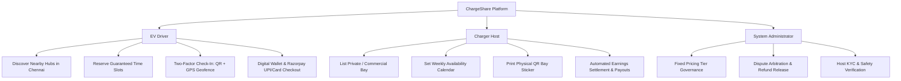
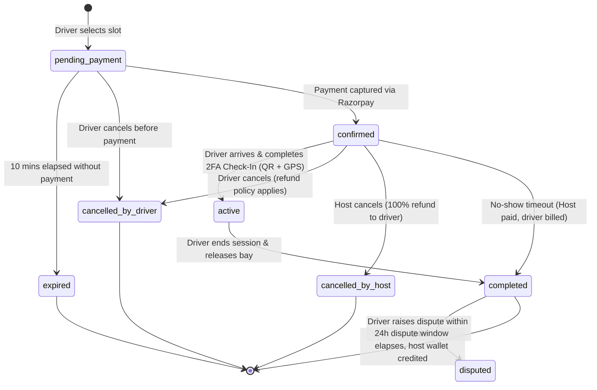

# ⚡ ChargeShare EV — Functional Specification Document (FSD)
**Version:** 2.0  
**Target Market:** Chennai Metropolitan Area & Tamil Nadu EV Corridors  
**Platform Architecture:** Flutter (Android & iOS) + Self-Hosted Ubuntu Backend (Supabase/PostgreSQL 15 + PostGIS)  
**Security Level:** Hardened (OWASP Mobile Top 10 Compliant, RLS Protected, Geofence Verified)  

---

## 1. Executive Summary & Business Vision

**ChargeShare** is a decentralized, peer-to-peer (P2P) electric vehicle charging network that unlocks private residential wallboxes, gated community parking bays, and commercial charging sockets for public EV drivers.

### 1.1 Context: Chennai EV Ecosystem
Chennai is one of India's fastest-growing EV adoption hubs, driven by the Tamil Nadu Electric Vehicle Policy, major automotive manufacturing corridors, and dense tech clusters along **Rajiv Gandhi Salai (OMR)**, **Mount-Poonamallee Road**, **Guindy Industrial Estate**, and **Ambattur**. 

Despite rapid vehicle adoption, EV drivers face acute "range anxiety" and charger congestion at public commercial stations. ChargeShare bridges this infrastructure gap by enabling:
- **Private Hosts:** Monetize idle 3.3 kW sockets, 7.4 kW home wallboxes, and 22 kW solar points.
- **EV Drivers:** Reserve guaranteed, collision-free charging slots with upfront fixed transparent pricing.
- **Hardware-Free Operation:** No expensive proprietary OCPP network hardware required; proprietary **Dynamic QR + GPS Proximity Geofencing** validates presence and handles check-in.

---

## 2. User Roles & Stakeholder Personas



### 2.1 Persona 1: EV Driver (Karthik Ramaswamy)
- **Profile:** IT Professional commuting between Anna Nagar and Sholinganallur (OMR).
- **Vehicle:** Tata Nexon EV Empowered (40.5 kWh, CCS2/Type 2).
- **Primary Need:** Guaranteed charging bay near office or shopping corridor without long queues.

### 2.2 Persona 2: Charging Bay Host (Senthil Kumar)
- **Profile:** Homeowner with a gated villa in Anna Nagar West with an installed 7.4 kW Type 2 Wallbox.
- **Primary Need:** Safe monetization of idle hours with strict privacy protections (exact home address hidden from strangers until reservation is paid).

### 2.3 Persona 3: Platform Super-Administrator
- **Profile:** ChargeShare Operations & Compliance Team.
- **Primary Need:** Manage platform commission (15%), regulate fixed pricing tiers, arbitrate disputes within the 24-hour settlement window, verify Host KYC documents.

---

## 3. System Architecture & High-Level Topology

```mermaid
flowchart LR
    subgraph ClientLayer [Client Applications]
        A1[Android App - APK / Play Store]
        A2[iOS App - App Store / TestFlight]
        A3[Flutter Web Admin Portal]
    end

    subgraph EdgeLayer [Ubuntu Server Edge & Security]
        N1[Nginx Reverse Proxy + SSL Let's Encrypt]
        U1[UFW Firewall: Ports 80 / 443 Only]
        K1[Kong API Gateway - Port 8000]
    end

    subgraph ServiceLayer [Self-Hosted Supabase Stack]
        G1[GoTrue Auth - Email OTP / JWT]
        P1[PostgREST Engine - Instant REST]
        R1[Realtime Server - WebSockets]
        S1[Storage API - Charger Photos & KYC]
        M1[Studio Web Dashboard]
    end

    subgraph DataLayer [PostgreSQL 15 Engine]
        D1[(PostgreSQL + PostGIS)]
        D2[pg_cron Background Schedulers]
        D3[Row-Level Security Policies]
        D4[btree_gist Collision Exclusion]
    end

    ClientLayer -->|HTTPS / TLS 1.3| EdgeLayer
    EdgeLayer --> ServiceLayer
    ServiceLayer --> DataLayer
```



---

## 4. Detailed Functional Requirements Specification (FRS)

### Module 1: Authentication, Onboarding & Identity Management
| Req ID | Feature | Specification |
|---|---|---|
| **AUTH-01** | **Role-Based Authentication** | Unified login screen with distinct role modes: **"I need to charge" (Driver)** and **"I own a charger" (Host)**. |
| **AUTH-02** | **Role Separation Guard** | Role checked immediately upon session initialization. A driver cannot access host payout functions; hosts cannot book their own chargers. |
| **AUTH-03** | **OTP Email Verification** | 6-digit numeric OTP sent via custom SMTP (Resend/SendGrid) with a 10-minute expiry window. No vulnerable magic links required. |
| **AUTH-04** | **Password Complexity Guard** | Minimum 8 characters with required upper, lower, and numeric/symbolic characters. Client & server validated. |
| **AUTH-05** | **Secure Token Storage** | JWT access tokens and refresh tokens encrypted in Android Keystore / iOS Keychain. |

### Module 2: Chennai Geospatial Map Discovery & Location Privacy Fuzzing
| Req ID | Feature | Specification |
|---|---|---|
| **MAP-01** | **Chennai Corridor Hotspots** | Map initialized with key EV corridors: **Anna Nagar West**, **OMR Sholinganallur**, **T. Nagar Central**, **Guindy Kathipara**, **Besant Nagar Coastal**, and **Velachery Bypass**. |
| **MAP-02** | **Dynamic GPS Geolocation** | Device GPS resolved via `geolocator`. Auto-centers to user's real location within Tamil Nadu; quick recenter floating action button. |
| **MAP-03** | **Location Privacy Fuzzing** | **Anti-Stalking Protection:** The `nearby_chargers` RPC snaps coordinates to a ~200m grid (`ST_SnapToGrid(location, 0.002)`). Exact address and host contact details remain hidden until a booking is paid. |
| **MAP-04** | **Connector & Budget Filtering** | Instant filters for connector types: `Type 2` (Wallbox), `CCS2` (DC Fast), `3-Pin 16A Socket` (Slow), and budget pricing (`<= ₹120/hr`). |

### Module 3: Time-Slot Scheduling & Collision-Free Reservation
| Req ID | Feature | Specification |
|---|---|---|
| **BOOK-01** | **30-Minute Quantum Slots** | Booking duration selectable in 30-minute intervals from 30 minutes minimum up to 12 hours maximum. |
| **BOOK-02** | **Collision Exclusion Constraint** | Guaranteed collision-free slots using PostgreSQL exclusion constraint: `EXCLUDE USING gist (charger_id WITH =, during WITH &&)`. Eliminates race conditions. |
| **BOOK-03** | **10-Minute Payment Hold** | Upon initiating booking, slot status transitions to `pending_payment` with a 10-minute hold. If unpaid within 10 minutes, `pg_cron` automatically frees the slot. |
| **BOOK-04** | **Anti-Hoarding Throttle** | Drivers are restricted to a maximum of 3 concurrent `pending_payment` bookings and 10 upcoming confirmed reservations to prevent inventory denial attacks. |

### Module 4: Hardware-Free Two-Factor Check-In (QR + GPS Geofence)
| Req ID | Feature | Specification |
|---|---|---|
| **CHKN-01** | **Physical QR Code Check-In** | Each charging bay features a unique high-contrast QR sticker containing the charger's cryptographic check-in code. |
| **CHKN-02** | **Proximity Geofence Verification** | When the driver scans or inputs the code, device GPS is sampled. If distance to the charging station exceeds **250 meters**, a proximity alert is triggered to prevent remote check-in fraud. |
| **CHKN-03** | **Check-In Time Window** | Check-in allowed from **15 minutes prior to slot start** until slot expiration. Attempts outside this window are rejected. |

### Module 5: Active Charging Session Management & Overstay Penalties
| Req ID | Feature | Specification |
|---|---|---|
| **SESS-01** | **Live Session Ticker** | Real-time elapsed timer displaying active session progress and remaining reserved time. |
| **SESS-02** | **Early Session Release** | Driver can end session early. If unused time exceeds 30 minutes, an automated refund request is queued for the unconsumed base amount. |
| **SESS-03** | **Overstay Penalty Engine** | 10-minute grace period after slot end time. If the vehicle is not unplugged, overstay billing applies at **1.5x the hourly rate** (`overstay_multiplier`). Outstanding dues block subsequent bookings until cleared. |

### Module 6: Payments, Razorpay Integration & Host Wallet Settlement
| Req ID | Feature | Specification |
|---|---|---|
| **PAY-01** | **Fixed Pricing Tiers** | Pre-set platform rates per tier: `AC_3` (₹55/hr), `AC_7` (₹120/hr), `AC_22` (₹330/hr), `DC_30` (₹600/hr). Eliminates price-gouging. |
| **PAY-02** | **Fee & Commission Split** | Driver pays `base_amount + 5% driver_fee (min ₹5)`. Host receives `base_amount - 15% platform_commission`. |
| **PAY-03** | **Razorpay India Integration** | Edge Functions generate signed Razorpay orders supporting UPI (GPay, PhonePe, Paytm), NetBanking, and RuPay/Visa/MasterCard credit/debit cards. |
| **PAY-04** | **Idempotent Webhook Verification** | Webhook verification matching `provider_order_id` with HMAC SHA256 signature verification. Replay attacks are rejected. |
| **PAY-05** | **24-Hour Settlement Window** | Host earnings are placed in a 24-hour holding window (`dispute_window_hours`) allowing driver issue resolution before moving to withdrawable wallet balance. |
| **PAY-06** | **KYC Guarded Payouts** | Host payouts require `kyc_status = 'verified'`. Minimum withdrawal threshold is ₹200. |

---

## 5. Security Protocols & Threat Mitigation Matrix

```
┌────────────────────────────────────────────────────────────────────────┐
│                   CHARGESHARE SECURITY MATRIX                          │
├────────────────────────┬─────────────────────────┬─────────────────────┤
│ Threat Vector          │ Attack Surface          │ Mitigation Protocol │
├────────────────────────┼─────────────────────────┼─────────────────────┤
│ Address Harvesting     │ Public API scraping     │ 200m spatial grid   │
│ & Stalking             │                         │ fuzzing pre-payment │
├────────────────────────┼─────────────────────────┼─────────────────────┤
│ Double Booking         │ High-concurrency race   │ btree_gist PostGIS  │
│ Overlap                │ on popular slots        │ exclusion constraint│
├────────────────────────┼─────────────────────────┼─────────────────────┤
│ Remote Check-In Fraud  │ Driver initiates charge │ GPS Geofence Check  │
│                        │ from home               │ (< 250m proximity)  │
├────────────────────────┼─────────────────────────┼─────────────────────┤
│ Slot Hoarding          │ Bot booking all slots   │ Max 3 pending holds │
│ Denial of Inventory    │ without paying          │ & 10 min TTL cron   │
├────────────────────────┼─────────────────────────┼─────────────────────┤
│ Man-in-the-Middle      │ Public Wi-Fi network    │ TLS 1.3, cleartext  │
│ Eavesdropping          │ inspection              │ traffic disabled    │
├────────────────────────┼─────────────────────────┼─────────────────────┤
│ SQL Injection & Path   │ RPC execution &         │ SECURITY DEFINER    │
│ Hijacking (CVE-level)  │ search_path poisoning   │ with strict schema  │
├────────────────────────┼─────────────────────────┼─────────────────────┤
│ Double Payment Capture │ Delayed webhook retries │ Idempotent order-ID │
│                        │ from payment gateway    │ ledger verification │
└────────────────────────┴─────────────────────────┴─────────────────────┘
```

---

## 6. State Machine Specifications

### 6.1 Booking Lifecycle State Machine



---

## 7. Non-Functional Requirements (NFR)

1. **Performance & Latency:**
   - Map rendering and nearby charger query responses under **400ms** on 4G/5G networks.
   - Quote calculation and price breakdown under **100ms**.
2. **Reliability & Availability:**
   - 99.9% uptime for the self-hosted Ubuntu backend.
   - Docker restart policy (`restart: unless-stopped`) and systemd watchdog service enabled.
3. **Cross-Platform Compatibility:**
   - **Android:** Android 5.0 (API 21) up to Android 15 (API 35). Full ProGuard / R8 minification enabled.
   - **iOS:** iOS 13.0 up to iOS 18.x. Compliant with App Store privacy string mandates.
4. **Data Privacy & Compliance:**
   - Compliant with India Digital Personal Data Protection Act (DPDP Act).
   - User phone numbers and KYC documents secured in private storage buckets with strict Row-Level Security.

---

## 8. Verification & Acceptance Criteria

- [x] All 6 Chennai EV hubs visible on map (Anna Nagar, OMR, T. Nagar, Guindy, Besant Nagar, Velachery).
- [x] Live GPS recentering accurately positions the user within Tamil Nadu.
- [x] iOS `Info.plist` includes all 4 mandatory privacy usage descriptions.
- [x] Android `AndroidManifest.xml` enforces `usesCleartextTraffic="false"` and TLS network security config.
- [x] Proximity Geofencing check executes prior to check-in session initiation.
- [x] Row-Level Security migrations `0001`, `0002`, and `0003` validate in PostgreSQL.
- [x] Ubuntu self-hosting Docker Compose and automated setup script ready for deployment.
